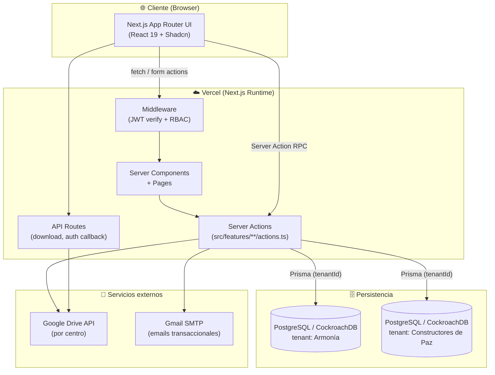
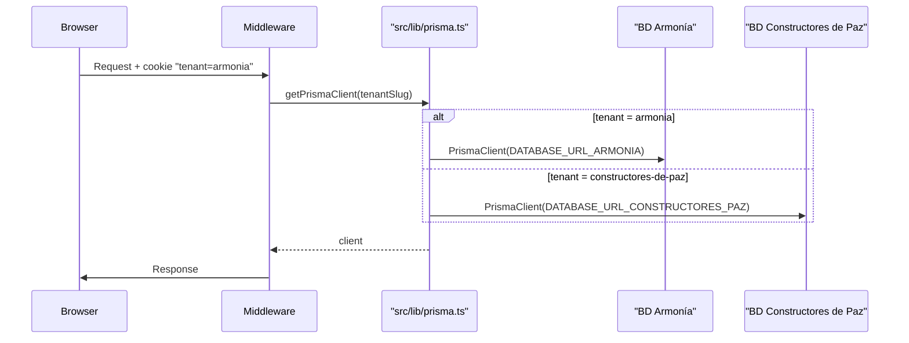
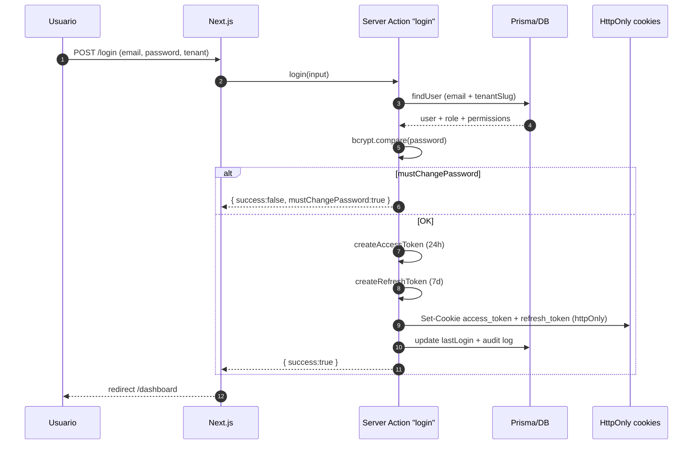
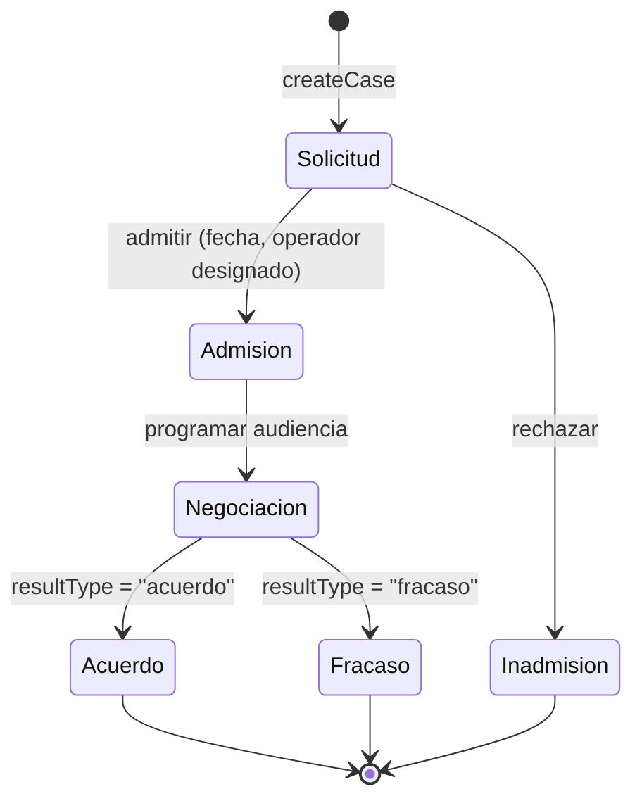
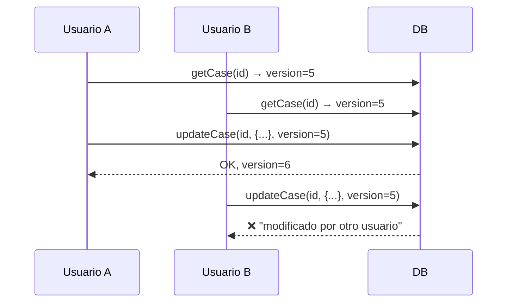
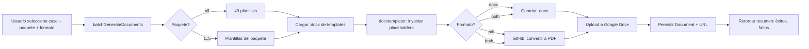
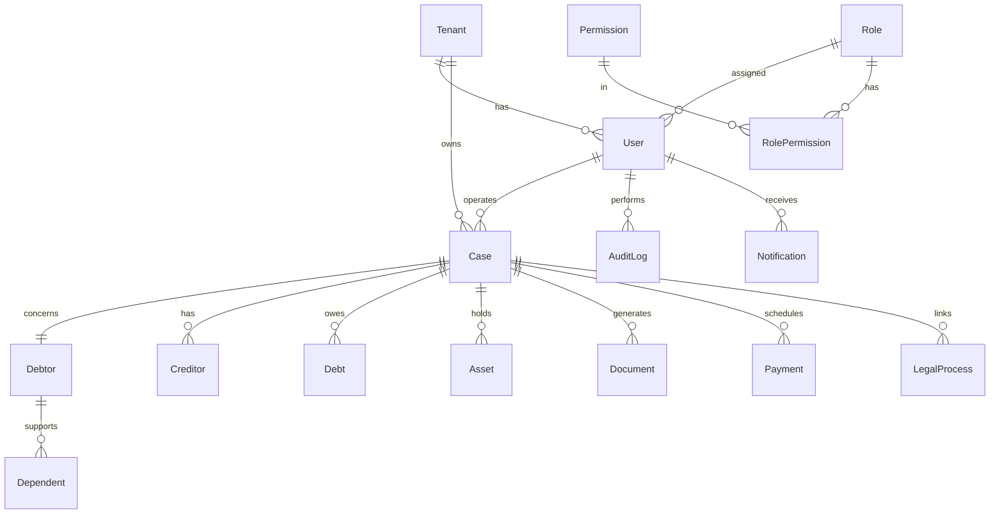
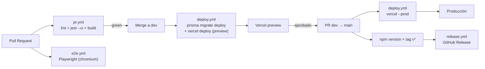
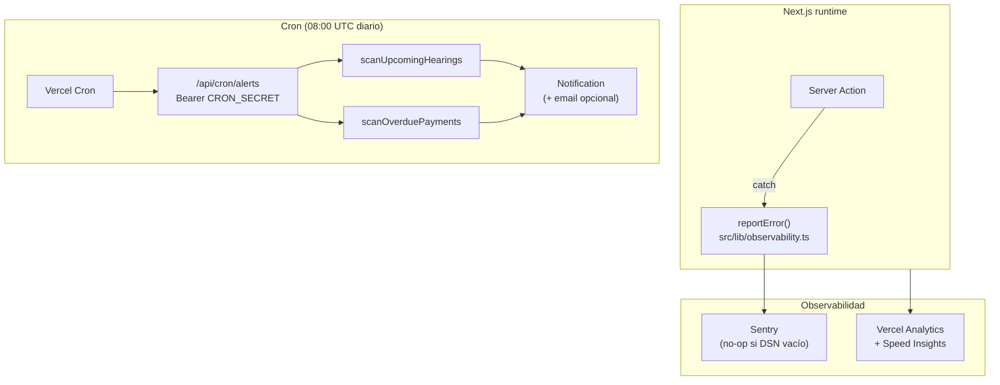

# Arquitectura — INSOLVENTIC

> Versión consolidada al cierre del proyecto (abril 2026). Este documento describe la arquitectura, los límites del sistema, los flujos críticos y las decisiones técnicas clave.

---

## 1. Vista de alto nivel



---

## 2. Multi-tenant por instancia de BD

Cada centro de conciliación opera con su propia base de datos aislada. El cliente Prisma se selecciona en tiempo de request:



**Garantías:**

- `tenantId` siempre presente en `where` de queries (no se comparte data entre centros).
- El JWT embebe `tenantId` → el usuario no puede forzar otro tenant sin re-login.
- `switchTenant` fuerza validación de `mustChangePassword` antes de emitir el nuevo token.

---

## 3. Capa de dominio (features/)

```
src/features/
├── auth/         ← login, logout, refresh, switchTenant, resetPassword, RBAC
├── case/         ← createCase, updateCase (optimistic lock), phase transitions
├── debtor/       ← CRUD deudores + historial de casos
├── creditor/     ← CRUD acreedores
├── document/     ← batchGenerateDocuments, templates, Google Drive upload
├── payment/      ← cronograma, registro manual, comprobantes, reportes
├── report/       ← estado de casos, trazabilidad de pagos
├── audit-log/    ← registro fire-and-forget de acciones críticas
├── notification/ ← notificaciones internas por usuario/rol
└── user/         ← CRUD usuarios, asignación de rol
```

Cada feature expone **server actions** (`'use server'`) con una firma canónica:

```ts
type ActionResult<T> =
  | { success: true; data: T }
  | { success: false; error: string };
```

Y siempre valida input con Zod antes de tocar Prisma.

---

## 4. Autenticación y sesión



**Hardening aplicado:**

- Refresh token **7 días** (antes 30).
- `refresh` y `switchTenant` revalidan `mustChangePassword` y limpian cookies si falla.
- `validateSession` corre en middleware: token inválido o expirado → redirect a `/login`.
- Logout revoca ambas cookies + audita la acción.

---

## 5. Ciclo de vida de un caso



**Optimistic locking** (campo `version` en `Case`):



El dialog de edición captura el error y cierra con toast rojo invitando a recargar.

---

## 6. Generación de documentos



**Decisiones:**

- Los documentos se generan a demanda, no en tiempo de creación del caso.
- Layout de Drive: `{caseFolder}/01-Generados/`, `02-Adjuntos/`, `03-Evidencias/`, `04-Historial/`.
- `layoutVersion` permite convivir layouts flat (legacy) y seccionado.

---

## 7. Capa de datos (Prisma)

**Modelos principales:**



- **~60 modelos** en total, incluyendo entidades específicas (Libranza, SuspendedService, Apoderado, ProcesoJudicial, Bien).
- **~400 campos** en `Case` cubren los 9 bloques del formulario maestro.
- Migraciones en `src/prisma/migrations/` gestionadas con `prisma migrate`.

---

## 8. CI/CD



> **Estrategia de ramas:** sólo dos ramas de larga vida — `dev` (integración) y `main` (producción).

**Workflows activos:**

| Workflow      | Trigger                  | Corre                                                                  |
| ------------- | ------------------------ | ---------------------------------------------------------------------- |
| `pr.yml`      | PR a dev / main          | `npm run lint` + `npx jest --ci` + `npm run build`                     |
| `e2e.yml`     | PR a dev / main + manual | Playwright (chromium) con Postgres service + seed determinístico       |
| `deploy.yml`  | Push a dev / main        | `prisma migrate deploy` + Vercel deploy (preview en dev, prod en main) |
| `release.yml` | Tag `v*`                 | Genera GitHub Release con el changelog                                 |

---

## 9. Observabilidad y alertas proactivas



**Errores**

- Toda feature importa `reportError` / `reportMessage` desde `src/lib/observability.ts`.
- Cuando `SENTRY_DSN` está vacío (dev / staging sin proyecto), el helper degrada a `console.error` — nunca lanza.
- `sentry.client.config.ts`, `sentry.server.config.ts` y `sentry.edge.config.ts` inicializan Sentry por runtime. `sendDefaultPii: false` y `beforeSend` limpia cookies.
- `@vercel/analytics` y `@vercel/speed-insights` se importan en `src/app/layout.tsx`; activos automáticamente al desplegar en Vercel.

**Alertas proactivas**

- `src/features/notification/alerts.ts` expone dos scanners puros (reciben un `PrismaClient` y un `tenantId`).
  - `scanUpcomingHearings(prisma, tenantId)` — busca casos con `hearingDate` (o `firstHearingDate` si el primero es null) dentro de `ALERTS_HEARING_LOOKAHEAD_HOURS` (default 48h).
  - `scanOverduePayments(prisma, tenantId)` — busca `Payment` con `status in ('pendiente','parcial')` y `dueDate < now`; los `pendiente` se marcan automáticamente como `vencido`.
- Ambos scanners **deduplican** contra `Notification` existente (mismo `type + relatedId + userId`) dentro de `ALERTS_DEDUPE_WINDOW_HOURS` (default 20h) para que correr el cron más de una vez al día no genere spam.
- `/api/cron/alerts` (Node runtime, no Edge) itera tenants, ejecuta ambos scanners y responde con un JSON agregado para los logs de Vercel.
- Vercel Cron se registra vía `vercel.json`:
  ```json
  { "crons": [{ "path": "/api/cron/alerts", "schedule": "0 8 * * *" }] }
  ```
- La autenticación es `Authorization: Bearer $CRON_SECRET`. Si `CRON_SECRET` está vacío, el endpoint responde **503** en lugar de ejecutar silenciosamente.
- Email opcional (`ALERTS_EMAIL_ENABLED=true`) usa `emailService.sendAlertEmail(...)` — requiere SMTP configurado.

---

## 10. Decisiones técnicas clave

| Decisión                                      | Justificación                                                           |
| --------------------------------------------- | ----------------------------------------------------------------------- |
| **Next.js App Router + Server Actions**       | RPC-like typesafe, sin necesidad de boilerplate de API routes.          |
| **Prisma con cliente por tenant**             | Aislamiento fuerte de datos entre centros; sin compartir conexión.      |
| **JWT HS256 con `jose`**                      | Edge-compatible (Next middleware), menos dependencias que jsonwebtoken. |
| **Cookies httpOnly**                          | Mitiga XSS; token nunca expuesto a JS del cliente.                      |
| **Optimistic locking (campo version)**        | Evita race conditions en edición simultánea sin bloquear UX.            |
| **docxtemplater + pdf-lib**                   | Librerías maduras, sin dependencias nativas (funciona en Vercel).       |
| **Google Drive como storage**                 | Los centros ya usan Drive; cero costo de infra adicional.               |
| **RBAC por permiso nombrado (`P.VER_CASOS`)** | Granularidad fina sin explosión de roles.                               |
| **Audit log fire-and-forget**                 | No bloquea la acción principal si el log falla.                         |
| **Zod en todo input**                         | Contrato tipado entre cliente y servidor; mensajes de error claros.     |

---

## 11. Riesgos residuales

| Riesgo                                                     | Mitigación actual                           | Recomendación futura                |
| ---------------------------------------------------------- | ------------------------------------------- | ----------------------------------- |
| Drive API rate limits en generación masiva                 | Retry con backoff en `google-drive.ts`      | Worker/queue si crece el volumen    |
| Drift entre schema.prisma e init migration                 | `prisma db push` en dev, baseline en deploy | Consolidar migraciones formales     |
| Google Drive refresh token expira si no se usa 6+ meses    | Alerta proactiva pendiente de implementar   | Rotación programada + health-check  |
| Cron de alertas depende de Vercel Cron (hobby: 1/día máx.) | Schedule diario a las 08:00 UTC             | Upgrade a Pro si se requiere >1/día |
| `CRON_SECRET` en Vercel como única defensa del endpoint    | Autorización `Bearer` comparada en código   | Rotación periódica del token        |

---

## 12. Para extender el sistema

**Agregar un nuevo permiso:**

1. Añadir a `src/lib/permissions.ts` objeto `P`.
2. Añadir al seed (`src/prisma/seed.ts`) y re-seedear.
3. Asignar al rol correspondiente en `adminPermissions` o vía UI.

**Agregar una nueva plantilla documental:**

1. Colocar `.docx` en `src/features/document/templates/`.
2. Registrarla en el manifiesto de paquetes.
3. Declarar sus placeholders en `docs/DICCIONARIO_VARIABLES.md`.

**Agregar un nuevo tenant/centro:**

1. Crear BD, añadir `DATABASE_URL_<SLUG>` al entorno.
2. Añadir el tenant en `src/lib/prisma.ts` resolver.
3. Seed específico con el rol Admin y usuario inicial.
4. Configurar carpeta raíz de Drive y credenciales OAuth del centro.

---

© 2025–2026 INSOLVENTIC
