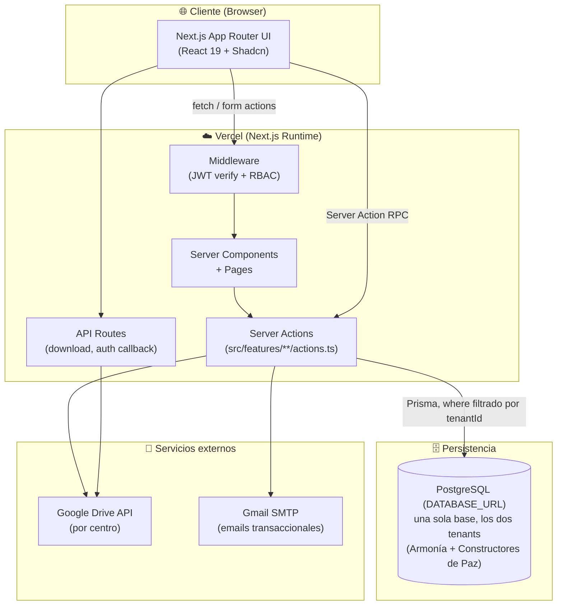
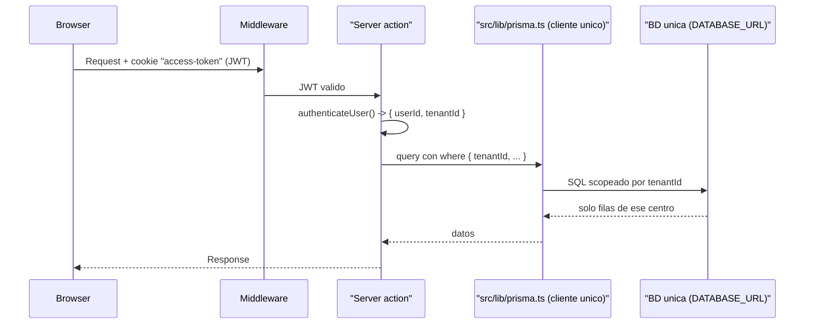
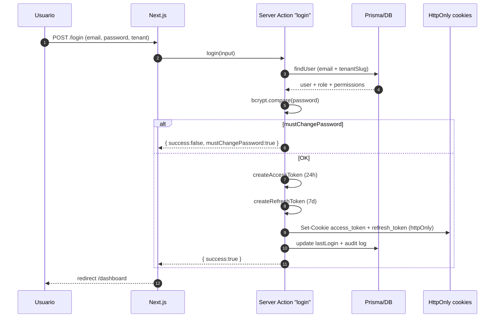
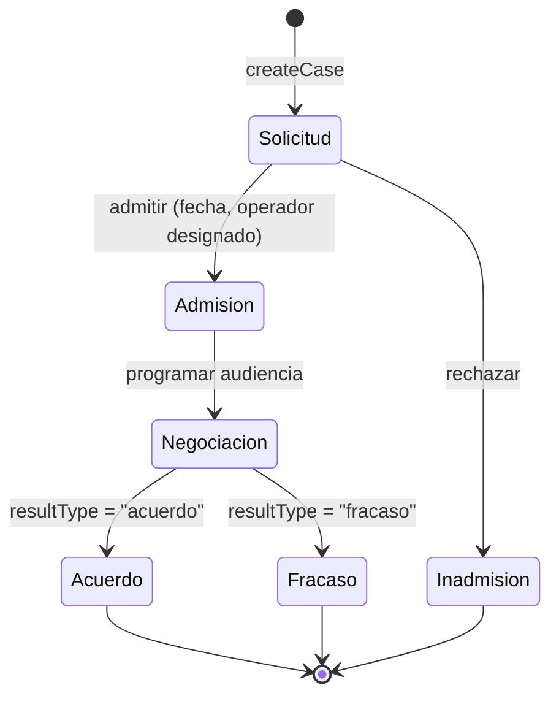
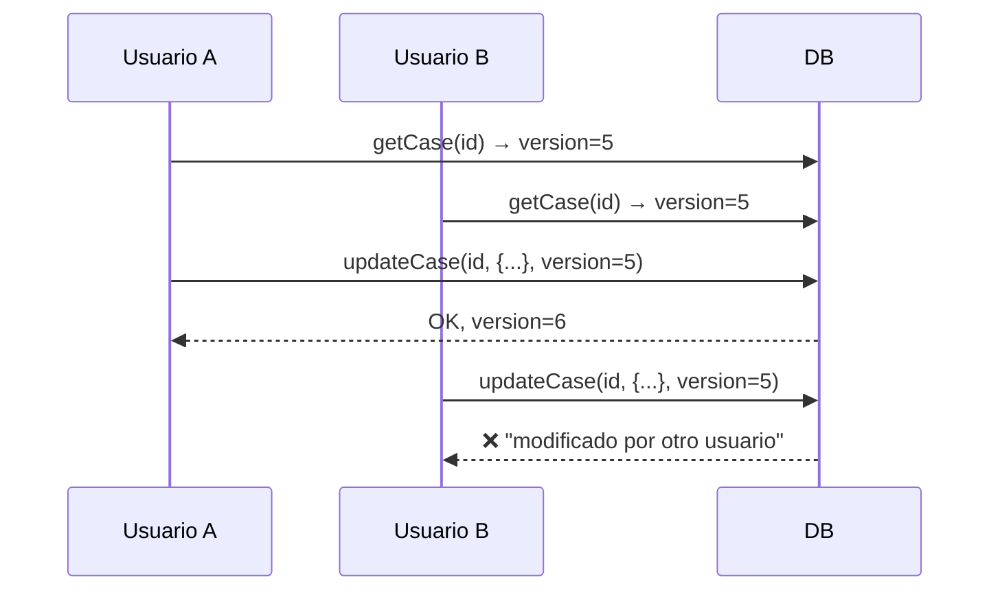
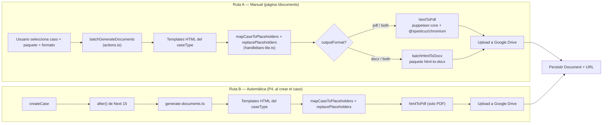
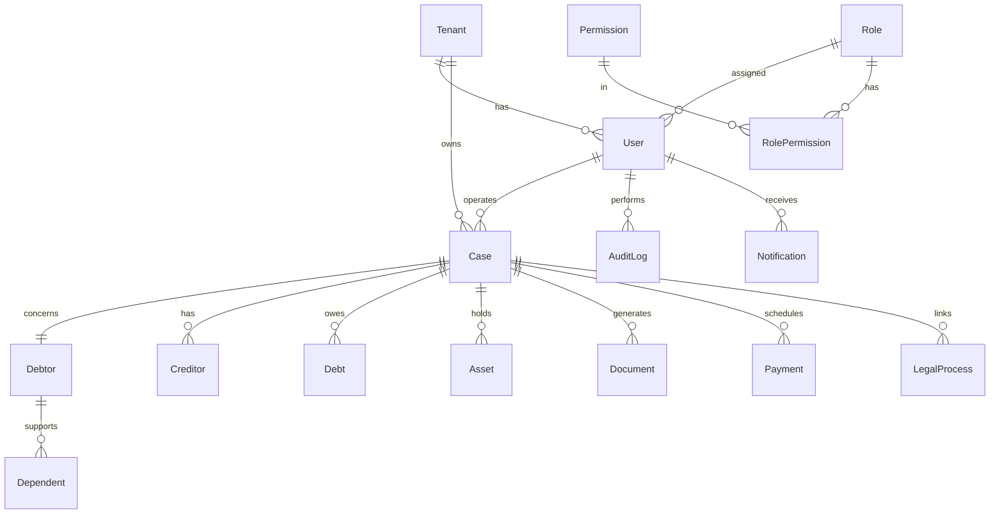
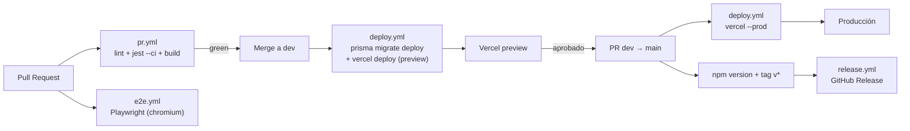
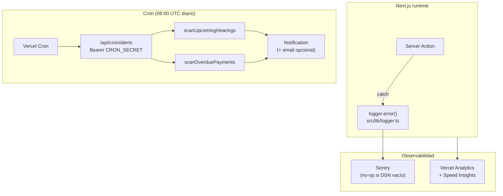

# Arquitectura — INSOLVENTIC

> Última actualización: julio 2026. El core del sistema cerró en abril 2026 (ver histórico abajo); en julio se sumó hardening de generación de documentos (lock anti-duplicados + background jobs) y observabilidad (logger estructurado). Este documento describe la arquitectura, los límites del sistema, los flujos críticos y las decisiones técnicas clave.

---

## 1. Vista de alto nivel



> La base única con aislamiento lógico por `tenantId` se detalla en §2 — no
> dos bases separadas por centro, que es lo que este diagrama mostraba
> hasta el 2026-10-18 (`DB_A`/`DB_C`, un nodo por tenant). Era la misma
> arquitectura "BD por centro" que §2 ya documentaba como corregida desde
> el 2026-10-09 (nota al final de esa sección) — este diagrama de §1 se
> había quedado sin actualizar en esa corrección.

---

## 2. Multi-tenant por `tenantId` en una sola BD

Los dos centros comparten **una única base de datos física** y **un único cliente Prisma**. El aislamiento es **lógico**: `tenantId` va en el `where` de cada query, y el tenant del usuario viaja dentro del JWT.



**Dónde está esto en el código:**

- `src/lib/prisma.ts` crea **un solo** `PrismaClient` (sin override de `datasources`), así que toma la `url` del datasource: `env("DATABASE_URL")`. Lo único que ese módulo expone por tenant es **metadata para la UI** (`getTenantConfig` / `getAvailableTenants`: nombre, slug, logo) — no clientes ni conexiones.
- `src/prisma/schema.prisma` declara un solo datasource: `url = env("DATABASE_URL")` + `directUrl = env("DIRECT_URL")`.
- Los usuarios son filas de la misma base con unicidad compuesta: `switchTenant` los busca por `email_tenantId`. Si cada centro tuviera su propia BD, bastaría con `email`.

**Garantías:**

- `tenantId` siempre presente en `where` de queries (no se comparte data entre centros).
- El JWT embebe `tenantId` → el usuario no puede forzar otro tenant sin re-login.
- `switchTenant` fuerza validación de `mustChangePassword` antes de emitir el nuevo token.

> **Corregido el 2026-10-09.** Esta sección describía una BD por centro, con un `getPrismaClient(tenantSlug)` que resolvía `DATABASE_URL_ARMONIA` / `DATABASE_URL_CONSTRUCTORES_PAZ` en tiempo de request. **Eso no existe en el código.** Esas dos variables sí están en `.env.example`, pero las lee únicamente `src/scripts/run-prisma.ts` (script manual) y `.github/workflows/e2e.yml`; el runtime las ignora. Para configurar o rotar credenciales en Vercel, las únicas que cuentan son `DATABASE_URL` y `DIRECT_URL` — el detalle está en `docs/RUNBOOK_ENV_VARS.md` §1 y §1.1.
>
> **Consecuencia de diseño, no cosmética:** al ser aislamiento lógico y no físico, una query a la que se le olvide el `tenantId` **devuelve datos del otro centro** en vez de fallar. Por eso la convención de `CLAUDE.md` ("toda server action: `authenticateUser()` → check de permiso → queries scoped por `tenantId`") es una barrera de seguridad, no un detalle de estilo.

---

## 3. Capa de dominio (features/)

```
src/features/
├── auth/         ← login, logout, refresh, switchTenant, resetPassword, RBAC
├── case/         ← createCase, updateCase (optimistic lock), phase transitions
├── debtor/       ← CRUD deudores + historial de casos
├── creditor/     ← CRUD acreedores
├── document/     ← batchGenerateDocuments, templates, Google Drive upload
├── payment/      ← cronograma, registro manual, comprobantes, reportes
├── report/       ← estado de casos, trazabilidad de pagos
├── audit-log/    ← registro fire-and-forget de acciones críticas
├── notification/ ← notificaciones internas por usuario/rol
└── user/         ← CRUD usuarios, asignación de rol
```

Cada feature expone **server actions** (`'use server'`) con una firma canónica:

```ts
type ActionResult<T> =
  | { success: true; data: T }
  | { success: false; error: string };
```

Y siempre valida input con Zod antes de tocar Prisma.

---

## 4. Autenticación y sesión



**Hardening aplicado:**

- Refresh token **7 días** (antes 30).
- `refresh` y `switchTenant` revalidan `mustChangePassword` y limpian cookies si falla.
- `validateSession` corre en middleware: token inválido o expirado → redirect a `/login`.
- Logout revoca ambas cookies + audita la acción.

---

## 5. Ciclo de vida de un caso



**Optimistic locking** (campo `version` en `Case`):



El dialog de edición captura el error y cierra con toast rojo invitando a recargar.

---

## 6. Generación de documentos

> **Corrección (ago-2026):** una pasada anterior de esta sección afirmó que el único formato de salida era PDF y que no existía ruta a `.docx`. Es incorrecto — hay una segunda ruta de generación manual que sí exporta `.docx`, vía un paquete distinto de `docxtemplater`. Ambas rutas están descritas abajo con evidencia de código.

Hay **dos rutas de generación, independientes entre sí**, ambas partiendo de las mismas plantillas HTML:



**Pipeline real (verificado en código, ago-2026):**

- Plantillas en **HTML puro** (`templates/{insolvency,conciliation,support-agreements}/*.html`, con hojas de estilo `CSS/*.css` propias por tipo) — no `.docx` como plantilla fuente en ninguna de las dos rutas.
- Placeholders resueltos por un motor propio y liviano: `mapCaseToPlaceholders` (`src/features/document/placeholder-mapper.ts`, escapado OWASP en el punto de fusión — ver Session 1 en `CLAUDE.md`) + `replacePlaceholders` (`src/features/document/handlebars-lite.ts`) — no `docxtemplater`.
- **Ruta A (manual, `src/features/document/actions.ts:batchGenerateDocuments`, invocada desde `src/app/documents/components/document-generation.tsx`):** el usuario elige caso + paquete + `outputFormat` (`pdf` / `docx` / `both`). PDF vía `htmlToPdf` (`src/lib/html-to-pdf.ts`, `puppeteer-core` + `@sparticuz/chromium`); DOCX vía `batchHtmlToDocx` (`src/lib/html-to-docx.ts`, que envuelve el paquete npm `html-to-docx` — conversión directa HTML→DOCX, **no** `docxtemplater\*\*).
- **Ruta B (automática, P4, disparada por `createCase` vía `after()`):** solo genera PDF, vía el mismo `htmlToPdf`. No tiene rama DOCX — `generate-documents.ts` no importa `html-to-docx`.
- `pdf-lib` no existe en el proyecto — nunca estuvo instalado (no confundir con `html-to-docx`, que sí lo está).
- **Excepción:** el reporte de Trazabilidad de Pagos exporta a Excel (`src/features/document/generate-excel.ts`) — no pasa por Puppeteer ni por `html-to-docx`, es un documento aparte.
- **Nota de higiene:** `docxtemplater` figura en `package.json` (`^3.66.7`) pero no tiene ninguna referencia en `src/` — dependencia muerta, probablemente residuo de un diseño previo a la migración a HTML+Puppeteer/html-to-docx. Candidato a `npm uninstall` en Fase 2 (no se tocó aquí por estar a días de la reunión).

**Decisiones:**

- La Ruta A (manual) es a demanda; la Ruta B (automática, P4) corre en background al crear el caso — ver P3/P4 abajo. No son mutuamente excluyentes: un caso recién creado ya tiene sus documentos iniciales en PDF (Ruta B) y el usuario puede regenerar/exportar a DOCX después desde `/documents` (Ruta A).
- Layout de Drive: `{caseFolder}/01-Generados/`, `02-Adjuntos/`, `03-Evidencias/`, `04-Historial/`.
- `layoutVersion` permite convivir layouts flat (legacy) y seccionado.

**Lock atómico anti-duplicados (P3, jul-2026):**

- Tabla `DocumentGenerationRequest` con unicidad parcial sobre `activeKey` (`"{caseId}:{kind}"` mientras la solicitud está activa, `NULL` al terminar — los `NULL` no colisionan en Postgres, sin triggers).
- Dos generaciones simultáneas del mismo tipo sobre el mismo caso son imposibles a nivel de BD: solo una gana el `activeKey`; el resto recibe `{ success: false, requestId }` con la solicitud activa (equivalente semántico a un 409 en server actions).
- Locks huérfanos (>10 min activos) se liberan y re-reclaman automáticamente.

**Generación en background (P4, jul-2026):**

- `createCase` responde de inmediato; el job de generación corre post-response vía `after()` de Next 15.
- Máquina de estados de la solicitud: `PENDING → PROCESSING → COMPLETED / COMPLETED_WITH_ERRORS / FAILED`.
- Retry con backoff exponencial (3×, `src/lib/retry.ts`) en subida a Drive y creación de carpetas (operaciones idempotentes).
- Notificación in-app (modelo `Notification` existente) al terminar o fallar; sin webhooks externos (sin consumidores hoy).
- Polling: server action `getGenerationRequestStatus(caseId)` — wiring en la UI (`documents-section`) pendiente.

---

## 7. Capa de datos (Prisma)

**Modelos principales:**



- **26 modelos** en total (`grep -c '^model ' src/prisma/schema.prisma`, reverificado 2026-10-18 — eran 27 en julio), incluyendo entidades específicas (Libranza, SuspendedService, Dependent, ProcesoJudicial, Bien). Ver `docs/DICCIONARIO_DATOS.md` y `docs/MODELO_ENTIDAD_RELACION.md` para el detalle completo.
- **~400 campos** en `Case` cubren los 9 bloques del formulario maestro.
- Migraciones en `src/prisma/migrations/` gestionadas con `prisma migrate`.

---

## 8. CI/CD



> **Estrategia de ramas:** sólo dos ramas de larga vida — `dev` (integración) y `main` (producción).

**Workflows activos:**

| Workflow      | Trigger                  | Corre                                                                  |
| ------------- | ------------------------ | ---------------------------------------------------------------------- |
| `pr.yml`      | PR a dev / main          | `npm run lint` + `npx jest --ci` + `npm run build`                     |
| `e2e.yml`     | PR a dev / main + manual | Playwright (chromium) con Postgres service + seed determinístico       |
| `deploy.yml`  | Push a dev / main        | `prisma migrate deploy` + Vercel deploy (preview en dev, prod en main) |
| `release.yml` | Tag `v*`                 | Genera GitHub Release con el changelog                                 |

---

## 9. Observabilidad y alertas proactivas



**Errores**

- `src/lib/logger.ts` es el **único** punto por el que el código de la aplicación reporta a Sentry (`logger.error` → `captureException` con `action` como tag; `logger.warn` → `captureMessage`). Ningún feature importa `@sentry/nextjs` ni tiene un wrapper propio; el cron de alertas y los scanners también van por el logger. La captura + `flush` se registra en el `waitUntil` de la plataforma para que Vercel no congele la función antes de que salga el evento.
- Cuando `SENTRY_DSN` está vacío (dev / staging sin proyecto), el logger degrada a la línea JSON en consola — nunca lanza.
- `sentry.client.config.ts`, `sentry.server.config.ts` y `sentry.edge.config.ts` inicializan Sentry por runtime. `sendDefaultPii: false` y `beforeSend` limpia cookies.
- `@vercel/analytics` y `@vercel/speed-insights` se importan en `src/app/layout.tsx`; activos automáticamente al desplegar en Vercel.

**Logger estructurado (Fase 2.1, jul-2026)**

- `src/lib/logger.ts` reemplaza `console.*` en código nuevo: niveles ERROR/WARN (consola JSON + Sentry) e INFO/DEBUG (consola JSON, gated por `LOG_LEVEL`; default `warn` en prod, `debug` en dev).
- El `context` de cada log pasa por redacción automática (password/token/email/phone/cedula → `[REDACTED]`).
- `beforeSend` de Sentry (`src/lib/sentry-scrub.ts`, compartido por los 3 configs) redacta cookies/headers/query params sensibles.
- Sin dependencia de Pino/Winston a propósito: en Vercel serverless stdout es el transport; el interface permite introducir una librería después sin tocar call-sites.
- Rutas críticas migradas (~50 refs): auth (actions, lib, hook `use-auth`), generación de documentos (job, service, retry) y error boundaries (`app/global-error.tsx`). Migración completa de los ~334 `console.*` restantes queda en el roadmap (Fase 2).

**Correlación por `requestId` (jul-2026)**

- `src/lib/request-context.ts` usa `AsyncLocalStorage` con `enterWith()` (no `run()`, porque `run()` dentro del middleware no se propaga a las server actions) para llevar un `requestId` por request.
- El edge runtime del middleware no comparte `AsyncLocalStorage` con el runtime Node de las actions, así que el `requestId` viaja también por header entre ambos; `auth/actions.ts` lo siembra en el `AsyncLocalStorage` de Node al entrar.
- El logger consulta el `requestId` activo vía un provider inyectado (`setRequestIdProvider`), sin importar `request-context.ts` directamente — inversión de dependencia para no acoplar el logger al mecanismo de propagación.
- Un `requestId` explícito pasado en el `context` de un log individual pisa el auto-inyectado.

**Alertas proactivas**

- `src/features/notification/alerts.ts` expone dos scanners puros (reciben un `PrismaClient` y un `tenantId`).
  - `scanUpcomingHearings(prisma, tenantId)` — busca casos con `hearingDate` (o `firstHearingDate` si el primero es null) dentro de `ALERTS_HEARING_LOOKAHEAD_HOURS` (default 48h).
  - `scanOverduePayments(prisma, tenantId)` — busca `Payment` con `status in ('pendiente','parcial')` y `dueDate < now`; los `pendiente` se marcan automáticamente como `vencido`.
- Ambos scanners **deduplican** contra `Notification` existente (mismo `type + relatedId + userId`) dentro de `ALERTS_DEDUPE_WINDOW_HOURS` (default 20h) para que correr el cron más de una vez al día no genere spam.
- `/api/cron/alerts` (Node runtime, no Edge) itera tenants, ejecuta ambos scanners y responde con un JSON agregado para los logs de Vercel.
- Vercel Cron se registra vía `vercel.json`:
  ```json
  { "crons": [{ "path": "/api/cron/alerts", "schedule": "0 8 * * *" }] }
  ```
- La autenticación es `Authorization: Bearer $CRON_SECRET`. Si `CRON_SECRET` está vacío, el endpoint responde **503** en lugar de ejecutar silenciosamente.
- Email opcional (`ALERTS_EMAIL_ENABLED=true`) usa `emailService.sendAlertEmail(...)` — requiere SMTP configurado.

---

## 10. Decisiones técnicas clave

| Decisión                                      | Justificación                                                           |
| --------------------------------------------- | ----------------------------------------------------------------------- |
| **Next.js App Router + Server Actions**       | RPC-like typesafe, sin necesidad de boilerplate de API routes.          |
| **Prisma con cliente por tenant**             | Aislamiento fuerte de datos entre centros; sin compartir conexión.      |
| **JWT HS256 con `jose`**                      | Edge-compatible (Next middleware), menos dependencias que jsonwebtoken. |
| **Cookies httpOnly**                          | Mitiga XSS; token nunca expuesto a JS del cliente.                      |
| **Optimistic locking (campo version)**        | Evita race conditions en edición simultánea sin bloquear UX.            |
| **docxtemplater + pdf-lib**                   | Librerías maduras, sin dependencias nativas (funciona en Vercel).       |
| **Google Drive como storage**                 | Los centros ya usan Drive; cero costo de infra adicional.               |
| **RBAC por permiso nombrado (`P.VER_CASOS`)** | Granularidad fina sin explosión de roles.                               |
| **Audit log fire-and-forget**                 | No bloquea la acción principal si el log falla.                         |
| **Zod en todo input**                         | Contrato tipado entre cliente y servidor; mensajes de error claros.     |

---

## 11. Riesgos residuales

| Riesgo                                                     | Mitigación actual                           | Recomendación futura                |
| ---------------------------------------------------------- | ------------------------------------------- | ----------------------------------- |
| Drive API rate limits en generación masiva                 | Retry con backoff en `google-drive.ts`      | Worker/queue si crece el volumen    |
| Drift entre schema.prisma e init migration                 | `prisma db push` en dev, baseline en deploy | Consolidar migraciones formales     |
| Google Drive refresh token expira si no se usa 6+ meses    | Alerta proactiva pendiente de implementar   | Rotación programada + health-check  |
| Cron de alertas depende de Vercel Cron (hobby: 1/día máx.) | Schedule diario a las 08:00 UTC             | Upgrade a Pro si se requiere >1/día |
| `CRON_SECRET` en Vercel como única defensa del endpoint    | Autorización `Bearer` comparada en código   | Rotación periódica del token        |

---

## 12. Para extender el sistema

**Agregar un nuevo permiso:**

1. Añadir a `src/lib/permissions.ts` objeto `P`.
2. Añadir al seed (`src/prisma/seed.ts`) y re-seedear.
3. Asignar al rol correspondiente en `adminPermissions` o vía UI.

**Agregar una nueva plantilla documental:**

1. Colocar `.docx` en `src/features/document/templates/`.
2. Registrarla en el manifiesto de paquetes.
3. Declarar sus placeholders en `docs/DICCIONARIO_PLACEHOLDERS.md`.

**Agregar un nuevo tenant/centro:**

1. Crear BD, añadir `DATABASE_URL_<SLUG>` al entorno.
2. Añadir el tenant en `src/lib/prisma.ts` resolver.
3. Seed específico con el rol Admin y usuario inicial.
4. Configurar carpeta raíz de Drive y credenciales OAuth del centro.

---

© 2025–2026 INSOLVENTIC
