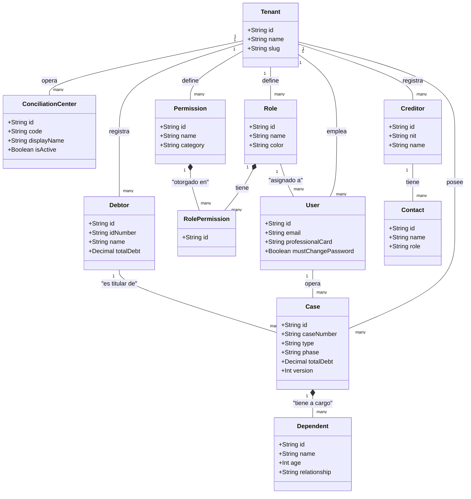
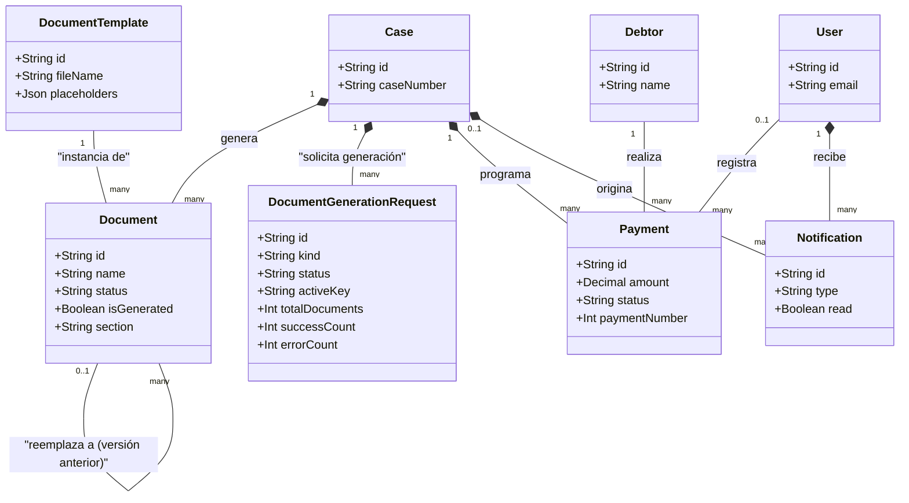

# Diagrama de Clases — INSOLVENTIC

> Basado en los mismos 27 modelos de `src/prisma/schema.prisma` que el MER (`docs/MODELO_ENTIDAD_RELACION.md`), pero con enfoque orientado a objetos: atributos representativos por clase + asociaciones/composiciones con cardinalidad, en vez de tablas/FKs. Comparten fuente pero responden preguntas distintas — el MER es para diseñar el esquema relacional, este diagrama es para entender la estructura de dominio como la vería un desarrollador.

**Convención de relación usada:**
- **Composición (`*--`)**: el hijo no puede existir sin el padre y se borra en cascada con él (`onDelete: Cascade` en el schema). Ej.: `Acreedor` no existe sin `Case`.
- **Asociación (`--`)**: relación por FK sin cascada explícita — el hijo referencia al padre pero Prisma no lo destruye automáticamente si el padre se borra.
- Misma división en 3 vistas que el MER, por la misma razón de legibilidad (27 clases en un solo diagrama no se lee).

---

## Vista 1 — Núcleo + Personas

---

## Vista 2 — Financiero/Patrimonial + Capa Definitivo

**Distinción de dos capas (misma que en el MER, repetida aquí porque es la que más se presta a malinterpretación en la reunión):** `Debt`/`Asset`/`LegalProcess`/`Libranza`/`SuspendedService` son la capa general — asociaciones normales, sin cascada. `Acreedor`/`Bien`/`ProcesoJudicial` son **composiciones** de `Case` (`onDelete: Cascade`): existen únicamente como snapshot congelado de las Secciones V/VI/VII del Formulario Definitivo y mueren con el caso. La UML aquí hace explícita una diferencia que en el ERD solo se ve en el texto de la relación.

```mermaid
classDiagram
    class Case {
        +String id
        +String caseNumber
    }
    class Creditor {
        +String id
        +String name
    }
    class Debtor {
        +String id
        +String name
    }
    class Debt {
        +String id
        +Decimal amount
        +Float interestRate
    }
    class Asset {
        +String id
        +String name
        +String type
        +Decimal value
    }
    class LegalProcess {
        +String id
        +String description
    }
    class Libranza {
        +String id
        +String payerName
        +Decimal deductedAmount
    }
    class SuspendedService {
        +String id
        +String creditorName
        +Decimal amountOwed
    }
    class Acreedor {
        +String id
        +String acreedorNombreRazonSocial
        +Decimal valorTotalObligacion
        +Boolean procesoJudicialEnCurso
    }
    class Bien {
        +String id
        +String bienTipo
        +Decimal bienValorComercial
        +Boolean bienEmbargado
    }
    class ProcesoJudicial {
        +String id
        +String tipoProceso
        +Decimal cuantiaProceso
        +String estadoProceso
    }

    Case "1" -- "many" Debt : "tiene (capa general)"
    Creditor "1" -- "many" Debt : "es acreedor de"
    Debtor "0..1" -- "many" Debt : "es deudor de"
    Case "1" -- "many" Asset : "tiene (capa general)"
    Debtor "0..1" -- "many" Asset : posee
    Case "1" -- "many" LegalProcess : "tiene (capa general)"
    Case "1" -- "many" Libranza : tiene
    Case "1" -- "many" SuspendedService : tiene

    Case "1" *-- "many" Acreedor : "snapshot §V Definitivo"
    Case "1" *-- "many" Bien : "snapshot §VI Definitivo"
    Case "1" *-- "many" ProcesoJudicial : "snapshot §VII Definitivo"
```

---

## Vista 3 — Documentos + Pagos + Operación

**No incluidas** (solo se relacionan con `Tenant`): `DocumentFromDrive`, `PasswordResetToken`, `AuditLog` — ver `docs/DICCIONARIO_DATOS.md`.

---

© 2025–2026 INSOLVENTIC — generado desde `src/prisma/schema.prisma`.
