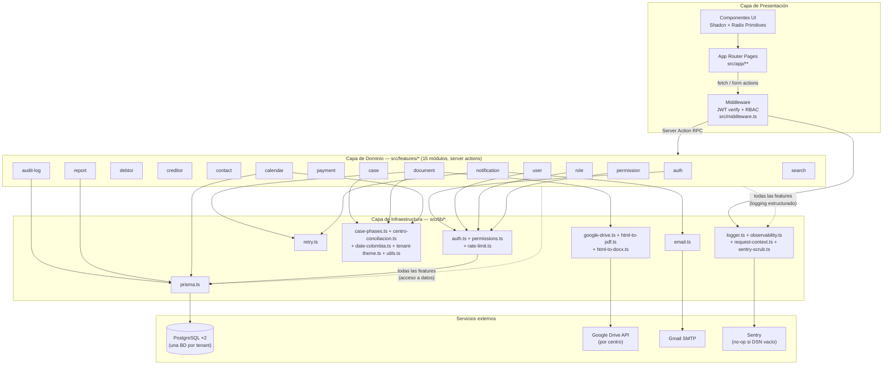

# Diagrama de Componentes — INSOLVENTIC

## Decisión de partida

`docs/ARQUITECTURA.md` §1 ("Vista de alto nivel") ya funciona como diagrama de componentes de alto nivel (Cliente → Middleware → Pages/Actions/API → Prisma → BD por tenant → Drive/SMTP) — **se deja tal cual, no se reemplaza**. Lo que faltaba, y es lo que aporta este documento, es el **desglose de la capa de dominio**: los 15 módulos de `src/features/*` como componentes propios, con sus dependencias reales hacia `src/lib/*` y hacia los servicios externos. Es un *zoom-in* de un solo recuadro ("Actions") del diagrama de ARQUITECTURA.md §1, no un diagrama nuevo desde cero.

---

## Diagrama

---

## Leyenda de capas

| Capa | Contiene | Responsabilidad |
|---|---|---|
| **Presentación** | `src/app/**` (App Router), `src/components/ui/*` (Shadcn/Radix) | Renderizado, formularios, llamadas a server actions vía RPC |
| **Dominio** | 15 módulos en `src/features/*`, cada uno con `actions.ts` (`'use server'`) + `schemas.ts` (Zod) | Lógica de negocio; toda acción valida input y pasa por `authenticateUser()` + check de permiso antes de tocar Prisma (ver `CLAUDE.md` → Convenciones) |
| **Infraestructura** | `src/lib/*`, agrupado aquí por responsabilidad (no son 18 nodos porque no cabría legible) | Utilidades transversales sin `'use server'` propio, compartidas entre features |
| **Externos** | PostgreSQL, Google Drive, Gmail SMTP, Sentry | Servicios fuera del runtime de Vercel |

**Edges punteados** (`-.->`) = dependencia transversal que aplica a las 15 features por igual (acceso a datos vía Prisma, logging estructurado) — dibujarla 15 veces no aportaría legibilidad. Las edges sólidas son dependencias específicas de una feature puntual (ej. solo `document` usa `google-drive.ts`/`html-to-pdf.ts`/`html-to-docx.ts`; solo `notification` usa `email.ts`, para el envío opcional de alertas por correo).

**No incluido en el diagrama** (para no duplicar `ARQUITECTURA.md` §1): el resolver de Prisma por tenant (`getPrismaClient(tenantSlug)`), el cron `/api/cron/alerts`, y el flujo de `after()` de P3/P4 — están documentados con su propio diagrama de secuencia en `ARQUITECTURA.md` §2, §6 y §9.

---

© 2025–2026 INSOLVENTIC.
