# Manual de Usuario — INSOLVENTIC

> Dirigido a operadores, administradores y personal de los centros de conciliación (Armonía, Constructores de Paz).

---

## 1. Ingreso al sistema

1. Ir a la URL del centro (ej. `https://insolventic.vercel.app`).
2. Seleccionar el **centro de conciliación** correspondiente (ver [Figura 1-1](#figura-1-1)).

   
   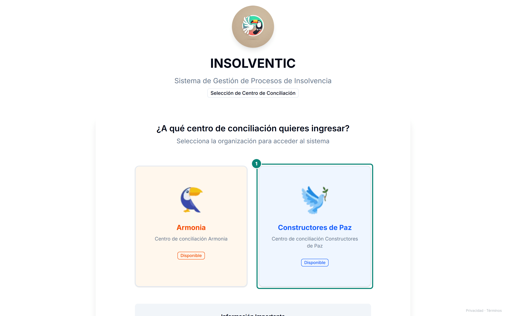

   _Figura 1-1. Selección del centro de conciliación._
   - ① Tarjeta del centro de conciliación.

3. Ingresar email y contraseña (ver [Figura 1-2](#figura-1-2)).

   
   

   _Figura 1-2. Formulario de inicio de sesión._
   - ① Centro elegido; con **Cambiar** se vuelve a la selección de centro.
   - ② Correo electrónico.
   - ③ Contraseña.
   - ④ Botón **Iniciar Sesión**.
   - ⑤ Enlace para recuperar la contraseña.

4. Si es tu primer ingreso, el sistema te forzará a **cambiar tu contraseña** antes de continuar.

Si el correo o la contraseña no coinciden, el formulario muestra un mensaje y no deja entrar (ver [Figura 1-3](#figura-1-3)).

_Figura 1-3. Mensaje cuando el correo o la contraseña no coinciden._

- ① Mensaje de credenciales inválidas.

**Olvidaste tu contraseña:** link "¿Olvidaste tu contraseña?" envía un email con token válido por 1 hora.

---

## 2. Roles y permisos

Los 5 roles con los que arranca cada centro (`src/prisma/seed.ts`):

| Rol                          | Alcance                                                                                                        |
| ---------------------------- | -------------------------------------------------------------------------------------------------------------- |
| **Administrador**            | Acceso total: casos, usuarios, roles, reportes, auditoría, eliminar casos/deudores/acreedores                  |
| **Operadora de Insolvencia** | Crear y editar casos, acreedores y deudores; generar documentos. No elimina casos ni administra usuarios/roles |
| **Abogado**                  | Crear y editar casos (ve también los casos propios); genera documentos. No elimina nada                        |
| **Asistente Legal**          | Solo consulta de casos (propios y en general) y de acreedores/deudores; genera documentos                      |
| **Secretaria**               | Solo consulta de casos y documentos — sin crear, editar ni generar                                             |

Los permisos son configurables por rol desde **Configuración → Roles**.

---

## 3. Dashboard

Al ingresar verás:

- **KPIs principales:** total de casos, activos, por fase, con acuerdos vigentes.
- **Casos recientes** del último mes.
- **Alertas:** audiencias próximas, plazos por vencer, notificaciones sin leer.

---

## 4. Gestión de casos

### 4.1 Crear un caso

`Casos → Crear nuevo caso`, y en el menú elegir el tipo de servicio (ver [Figura 4.1-1](#figura-4-1-1)).

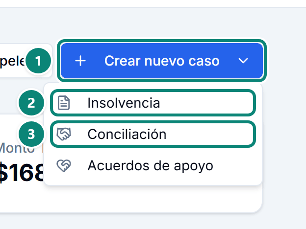

_Figura 4.1-1. Botón «Crear nuevo caso» y su menú de tipos de servicio._

- ① Botón **Crear nuevo caso**.
- ② Opción **Insolvencia**.
- ③ Opción **Conciliación**.

El formulario se abre en la pestaña 1; las pestañas se recorren con **Siguiente** o haciendo clic en ellas (ver [Figura 4.1-2](#figura-4-1-2)).

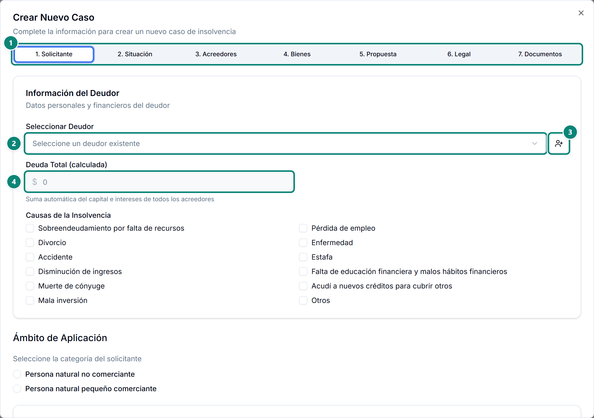

_Figura 4.1-2. Formulario de alta de insolvencia al abrirse, en la pestaña Solicitante._

- ① Las siete pestañas del formulario.
- ② Selector del deudor.
- ③ Botón para crear un deudor nuevo.
- ④ Deuda total, que se calcula a partir de los acreedores.

Si al pulsar **Crear Caso** falta un dato obligatorio, el formulario vuelve a la primera pestaña con errores, marca en rojo las pestañas y los campos que faltan, y un aviso «Campos incompletos» los enumera (ver [Figura 4.1-3](#figura-4-1-3)).

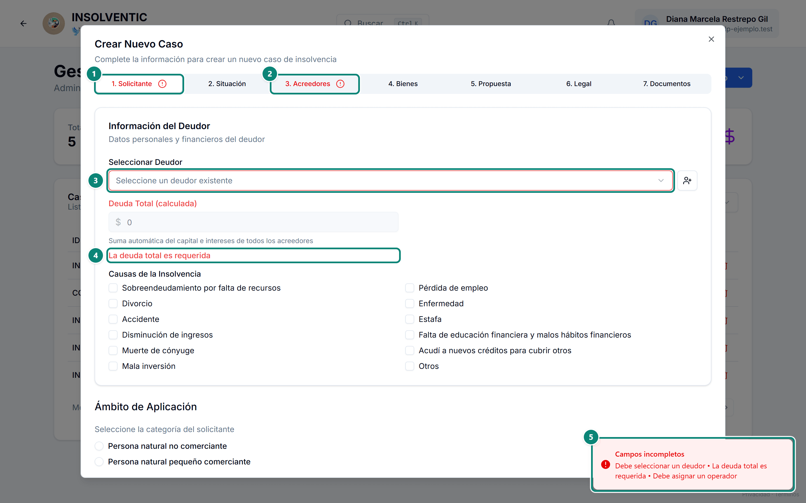

_Figura 4.1-3. Errores de validación al intentar crear el caso sin los datos obligatorios._

- ① Pestaña **Solicitante**, marcada con errores.
- ② Pestaña **Acreedores**, marcada con errores.
- ③ Selector del deudor sin diligenciar.
- ④ Mensaje del campo con error.
- ⑤ Aviso «Campos incompletos» con la lista de lo que falta.

**Pestañas del formulario (insolvencia):**

1. **Solicitante** — deudor (se elige uno existente o se crea con el botón de al lado), causas de la insolvencia, ámbito de aplicación (persona natural no comerciante o pequeño comerciante) y operador del caso. La deuda total se calcula sola a partir de los acreedores (ver [Figura 4.1-4](#figura-4-1-4) y [Figura 4.1-5](#figura-4-1-5)).

   
   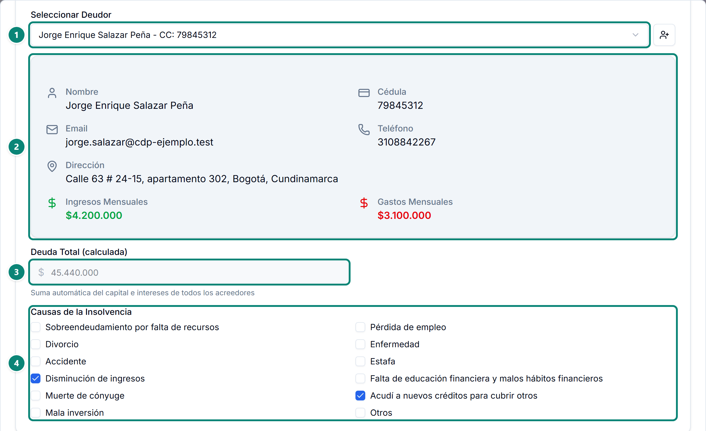

   _Figura 4.1-4. Pestaña Solicitante diligenciada: deudor, ficha, deuda total y causas._
   - ① Deudor seleccionado.
   - ② Ficha con los datos del deudor.
   - ③ Deuda total, calculada desde los acreedores.
   - ④ Causas de la insolvencia.

   
   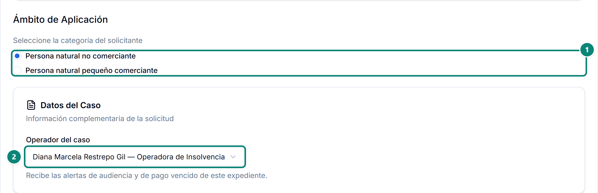

   _Figura 4.1-5. Ámbito de aplicación y operador del caso._
   - ① Ámbito de aplicación.
   - ② Operador del caso; recibe las alertas de audiencia y de pago vencido del expediente.

2. **Situación** — cónyuge o compañero(a) permanente (sociedad conyugal vigente/disuelta), información laboral y económica (ingresos, gastos, recursos disponibles, obligaciones alimentarias), cesación de pagos y procesos judiciales en curso (ver [Figura 4.1-6](#figura-4-1-6)).

   
   

   _Figura 4.1-6. Ingresos, gastos y recursos disponibles del deudor._
   - ① Ingreso principal mensual.
   - ② Total de gastos mensuales, calculado.
   - ③ Recursos disponibles (ingresos menos gastos), base de la cuota de la propuesta.

3. **Acreedores** — acreedores y deudas: capital, intereses, tasa y tipo de deuda; la clasificación del crédito, la clase y el % de acreencia se calculan solos. Incluye también libranzas y servicios públicos suspendidos (ver [Figura 4.1-7](#figura-4-1-7)).

   
   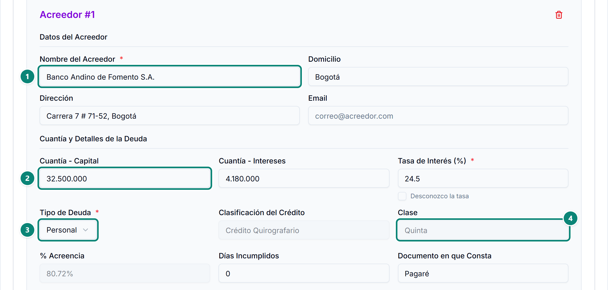

   _Figura 4.1-7. Datos de un acreedor y su deuda._
   - ① Nombre del acreedor.
   - ② Capital de la deuda, con separador de miles.
   - ③ Tipo de deuda.
   - ④ Clase, calculada según el tipo de deuda.

4. **Bienes** — muebles, inmuebles, vehículos, con avalúo.
5. **Propuesta** — resumen de obligaciones por clase y flujo de caja (cuota mensual y plazo), que se calculan con los datos de las pestañas 2 y 3; período de gracia, dación en pago, quitas, condonación de intereses y orden de prelación (ver [Figura 4.1-8](#figura-4-1-8)).

   
   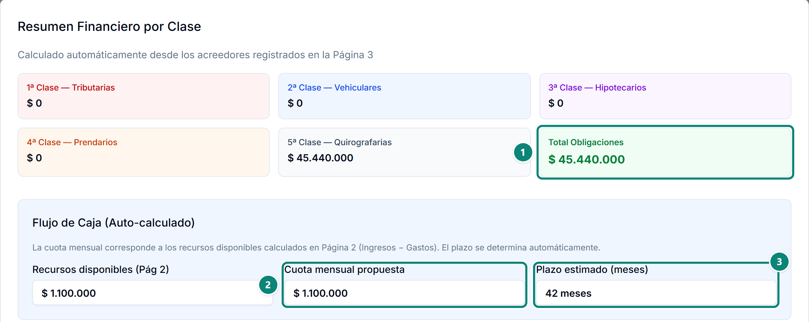

   _Figura 4.1-8. Resumen por clase y flujo de caja calculados._
   - ① Total de obligaciones.
   - ② Cuota mensual propuesta.
   - ③ Plazo estimado.

6. **Legal** — declaraciones (veracidad, buena fe, no ocultamiento, autorizaciones), tarifa y fundamentos de derecho, notificaciones, apoderado y firma del solicitante.
7. **Documentos** — carga de los documentos del caso (ver el párrafo siguiente).

**Documentos del caso:** PDF, JPG o PNG, máx. 4 MB por archivo, en la pestaña de documentos del formulario, al crear o al editar el caso. No hay límite para el total. Un archivo más pesado se rechaza al elegirlo; un PDF comprimido o una foto en menor resolución suelen caber. Si alguno no se puede subir al guardar, los demás quedan guardados y un aviso dice cuál falló y por qué; se vuelve a adjuntar desde **Editar caso → Documentos**.

La [Figura 4.1-9](#figura-4-1-9) muestra la pestaña con un archivo rechazado por tamaño.

_Figura 4.1-9. Carga de documentos, con un archivo rechazado por tamaño._

- ① Formatos admitidos y tamaño máximo por archivo.
- ② Documento obligatorio cargado.
- ③ Documento obligatorio pendiente.
- ④ Aviso de rechazo, con el peso del archivo.

Con todo completo, **Crear Caso** guarda el expediente y el caso aparece en el listado con su número (ver [Figura 4.1-10](#figura-4-1-10)).

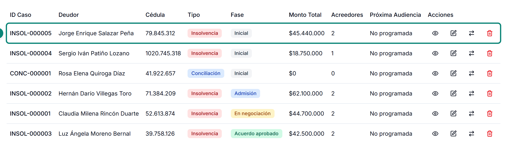

_Figura 4.1-10. El caso recién creado en el listado de casos._

- ① Caso nuevo, con el número que le asignó el sistema.

**Para un caso de Conciliación**, el formulario cambia a tres pestañas
(Solicitante, Partes y Solicitud): asunto y cuantía,
audiencia virtual (Zoom: ID, código de acceso, enlace), convocante/convocado
y sus apoderados, fechas reales del trámite (solicitud, citación,
desistimiento), menores de edad (alimentos/unión marital), cláusulas del
acuerdo, causa de terminación anormal, resultado del informe del
conciliador, y — si aplica el trámite — los datos de la Aclaración de Acta
(qué campo tenía el error, valor incorrecto/correcto) y de las referencias
del acta de unión marital que se disuelve o aclara (ver [Figura 4.1-11](#figura-4-1-11) y [Figura 4.1-12](#figura-4-1-12)).

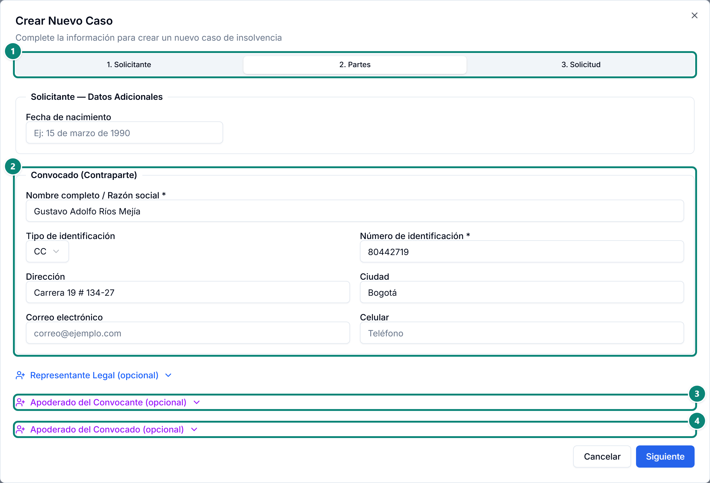

_Figura 4.1-11. Conciliación: pestaña Partes._

- ① Las tres pestañas de la conciliación.
- ② Datos del convocado (contraparte).
- ③ Apoderado del convocante.
- ④ Apoderado del convocado.

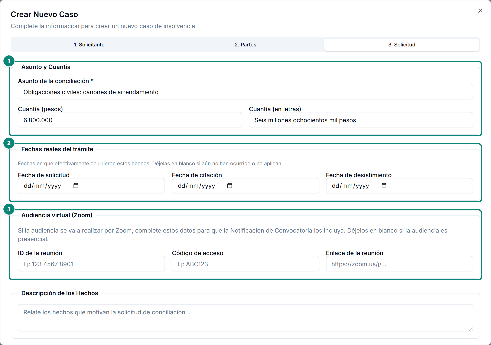

_Figura 4.1-12. Conciliación: pestaña Solicitud._

- ① Asunto y cuantía.
- ② Fechas reales del trámite.
- ③ Audiencia virtual (Zoom).

El sistema guarda como **borrador** al avanzar entre secciones.

**Montos en pesos:** todo campo de dinero (ingresos, gastos, deudas,
cuantía) muestra el separador de miles mientras se escribe —`1.500.000`, no
`1500000`— para que sea más fácil verificar que el monto es el correcto (ver
[Figura 4.1-6](#figura-4-1-6) y [Figura 4.1-7](#figura-4-1-7)).

### 4.2 Filtrar y buscar casos

En el listado puedes filtrar por:

- Estado (activo / cerrado / todos)
- Fase (Solicitud / Admisión / Negociación / Terminación)
- **Tipo de servicio** (Insolvencia / Conciliación / Acuerdo de Apoyo)
- Texto libre (número de caso, nombre del deudor, cédula)

### 4.3 Editar un caso

Abrir el caso → **Editar**. El sistema protege contra ediciones concurrentes:

> ⚠️ **Si dos usuarios editan el mismo caso al tiempo**, quien guarde último recibirá el mensaje _"Este caso fue modificado por otro usuario. Recargue y vuelva a intentarlo."_ — el dialog se cerrará automáticamente.

### 4.3.1 Eliminar y restaurar un caso (papelera)

**Eliminar** un caso lo manda a la **papelera**: deja de aparecer en listados, búsquedas, reportes, alertas, pagos y documentos, pero no se pierde nada. Hay que escribir el número del caso para confirmar.

- **Ver la papelera y restaurar:** botón **Papelera** en Gestión de Casos. Lo ve quien puede eliminar casos (Administrador y Operadora de Insolvencia). **Restaurar** devuelve el caso tal como estaba.
- **Eliminar definitivamente:** solo el **Administrador**, desde la papelera, escribiendo de nuevo el número del caso. Borra el caso y todo lo asociado y **no se puede deshacer**. Úselo solo cuando corresponda una supresión de datos (ver el procedimiento de derechos ARCO).
- Un **deudor** que tenga casos (incluidos los de la papelera) no se puede eliminar: primero hay que eliminar sus casos.

### 4.4 Transiciones de fase

El expediente tiene 13 fases (`Inicial` → `Terminado`). En el detalle del
caso solo aparecen los botones de las transiciones **válidas desde la fase
actual** — el sistema no deja saltar fases.

**Las 5 fases que distinguen el desenlace de la negociación**, en vez de
caer todas a `Fracaso` con el mismo paquete de documentos:

| Fase                  | Cuándo se usa                                                                                                   |
| --------------------- | --------------------------------------------------------------------------------------------------------------- |
| **Rechazo**           | La solicitud se rechaza de entrada, antes de admitir — no es un fracaso de negociación                          |
| **Retiro**            | El solicitante se retira **antes** de que el caso sea admitido                                                  |
| **Desistimiento**     | El deudor abandona el trámite **después** de admitido. Pide un subtipo: _No pago de tarifas_ o _Abandono total_ |
| **Acuerdo impugnado** | Hay una impugnación pendiente ante el juez sobre un acuerdo ya aprobado                                         |
| **Acuerdo reformado** | El juez ordena corregir el acuerdo y se corrige dentro del plazo                                                |

**Fracaso** (la fase que ya existía) pide un subtipo de entre 13 — por
ejemplo _Inasistencia del deudor_, _Incumplimiento_, _Impugnación del
acuerdo_, _Muerte del deudor_ — porque cada uno genera un paquete de
documentos distinto.

Otros botones contextuales que verás:

- **Admitir** (desde Inicial) → exige fecha de admisión, operador designado, fecha de aceptación.
- **Programar primera audiencia** (desde Admisión).
- **Registrar resultado** (desde En negociación / Audiencia programada) → Acuerdo aprobado, Desistimiento o Fracaso.
- **Cerrar caso** (Terminado) → marca `resultDate` y bloquea edición.

Cada transición queda registrada en el **Audit Log**.

> `Rechazo`, `Retiro`, `Acuerdo impugnado` y `Acuerdo reformado` todavía no
> tienen su propio paquete de documentos (pendiente del abogado, ver
> `docs/DISENO_FASES_NUEVAS_2026-09-11.md` §3) — hoy, al generar documentos
> para un caso en una de esas 4 fases, el sistema usa el Paquete 1 por
> defecto.

---

## 5. Deudores, acreedores, apoderados

Módulos independientes con CRUD. Al crear un caso puedes vincular un deudor existente o crear uno nuevo al vuelo.

**En conciliación:** hay dos roles — **Convocante** (solicitante) y **Convocado** (contraparte). Se gestionan como acreedores bilaterales.

---

## 6. Generación de documentos

`Documentos → Generar documentos`

1. **Seleccionar caso.**
2. **Seleccionar paquete** — el número de documentos de cada opción se
   calcula en vivo contra las plantillas reales, así que puede variar si se
   agrega o quita una plantilla:
   - Todos los paquetes
   - Paquete 1 — Solicitud
   - Paquete 2 — Admisión y Apertura
   - Paquete 3 — Negociación y Acuerdo
   - Paquete 4 — Terminación Normal
   - Paquete 5 — Fracaso
3. **Seleccionar formato:** Solo PDF / Solo Word / Ambos.
4. **Generar documentos.**

**Lotes grandes (Todos los paquetes, o Paquete 5) se generan por tandas.**
El botón muestra _"Generando tanda X de Y..."_ mientras corre — es normal
que un lote grande tarde más que uno chico, y no se puede volver a hacer
clic hasta que termine. Si una tanda falla a mitad de camino (por ejemplo,
un corte de red), las tandas que ya terminaron **no se pierden**: aparece
un botón **"Reintentar"** que retoma solo la tanda que faltó, no el lote
completo desde el principio.

El sistema:

- Valida que el caso tenga los campos requeridos (muestra faltantes).
- Sube automáticamente los archivos a la carpeta del caso en **Google Drive**.
- Guarda un registro en la pestaña _Documentos_ del caso con link directo.
- Usa el membrete y la firma propios del centro de conciliación del caso
  (logo, nombre del centro, firma de la conciliadora) — cada centro ve sus
  documentos con su propia identidad, no una genérica.

**Alertas que puedes ver:**

- ⚠️ _Este caso ya tiene N documentos generados. Al generar nuevamente se crearán adicionales sin reemplazar los existentes._
- ❌ _Error leyendo plantilla:_ significa que la plantilla base tiene un problema — contacta a soporte.
- ⚠️ _No se generó por datos incompletos:_ el documento se salta (no cuenta como error) porque al caso le falta un dato obligatorio para esa plantilla — complétalo y vuelve a generar.

---

## 7. Vista de documentos del caso

En el detalle de caso → pestaña **Documentos**:

- **Árbol de carpetas** por sección (01-Generados, 02-Adjuntos, 03-Evidencias, 04-Historial).
- **Vista previa inline** para PDFs e imágenes (click en el ícono de ojo+documento).
- **Descargar** (click en el ícono de ojo) abre el archivo en Drive.
- **Subir adjunto** (permiso requerido).

---

## 8. Trazabilidad de pagos

### 8.1 Generar cronograma

En la pestaña **Pagos** del caso, botón **"Generar cronograma"** crea las cuotas según la propuesta de pago aprobada.

### 8.2 Registrar un pago

Botón **"Registrar pago"** (o "Pagar" en una cuota):

- Monto
- Fecha de pago
- Método (Transferencia, Efectivo, Cheque, PSE, Otro)
- Observaciones
- **Comprobante** (PDF / JPG / PNG, máx. 4 MB)

El comprobante se sube automáticamente a `{caso}/Comprobantes/` en Drive. Si el archivo pesa más de 4 MB, el formulario lo rechaza al elegirlo y dice cuánto pesa; una foto o un PDF escaneado suelen bajar de ese tamaño comprimiéndolos o guardándolos en menor resolución.

### 8.3 Estados de pago

| Estado      | Significado                           |
| ----------- | ------------------------------------- |
| `pendiente` | Cuota programada, sin pago registrado |
| `pagado`    | Pago completo recibido                |
| `parcial`   | Pago menor al monto esperado          |
| `vencido`   | `dueDate` superada sin pago           |

### 8.4 Reporte de trazabilidad

`Reportes → Trazabilidad de Pagos`:

- Filtros: estado, fechas, tiene comprobante, búsqueda.
- Summaries: total recaudado, pendiente, vencido, casos con pagos.
- Tabla expandible por caso con barra de progreso `pagado / obligación total`.

---

## 9. Reportes

| Reporte                   | Contenido                                                          |
| ------------------------- | ------------------------------------------------------------------ |
| **Estado de Casos**       | Distribución por tipo, fase, operador. Montos solo en Insolvencia. |
| **Trazabilidad de Pagos** | Ver sección 8.4                                                    |

Los reportes se exportan a Excel/CSV (próximamente).

---

## 10. Gestión de usuarios y roles

`Usuarios` (permiso requerido):

- Crear usuario (email, nombre, rol, tenant).
- Asignar rol.
- Activar / desactivar.
- **Forzar cambio de contraseña en próximo login**.

`Configuración → Roles`:

- Crear rol nuevo.
- Marcar permisos por módulo.

---

## 11. Auditoría

`Auditoría` (permiso requerido): bitácora cronológica de acciones críticas:

- Login / logout
- Creación, edición, eliminación de casos/deudores/acreedores
- Cambios de fase
- Generación de documentos
- Registro de pagos
- Cambios de rol/permisos

Filtrable por usuario, acción, fecha.

---

## 12. Notificaciones

Icono de campana en la barra superior muestra notificaciones internas. Dos fuentes:

**Eventos del sistema (tiempo real):**

- Caso creado / actualizado / eliminado
- Acreedor, deudor, usuario, rol (alta/modificación/baja)

**Alertas proactivas (se generan automáticamente cada día a las 08:00 UTC):**

- **Audiencia próxima** (ícono calendario, ámbar): aparece 48h antes de la fecha de audiencia del caso que tengas asignado.
- **Pago vencido** (ícono triángulo, rojo): aparece cuando un pago programado pasa su fecha límite sin registrarse. El estado del pago pasa automáticamente a "vencido".

Al hacer click se marcan como leídas. Si tu administrador activa `ALERTS_EMAIL_ENABLED`, también recibirás un correo.

---

## 13. Cambio de centro (multi-tenant)

Si tu usuario tiene acceso a varios centros, en el perfil aparece **Cambiar centro**. El sistema:

1. Revalida tu sesión.
2. Revalida `mustChangePassword`.
3. Emite un nuevo token con el `tenantId` del centro destino.
4. Te redirige al dashboard del nuevo centro.

---

## 14. Preguntas frecuentes

**¿Por qué no puedo editar un caso?**

- Puede estar cerrado (`resultDate` ya fijado).
- No tienes el permiso "Editar casos".
- Tu rol solo tiene permiso "Ver casos".

**El documento generado dice "Error leyendo plantilla":**
Contacta a soporte. La plantilla `.docx` base puede estar corrupta o faltar.

**Subí un comprobante pero no aparece el link:**
Google Drive puede tardar unos segundos en propagar permisos. Recarga la pestaña.

**¿Puedo recuperar un caso eliminado?**
No directamente desde la UI. Contacta a un administrador — la auditoría conserva evidencia y se puede restaurar desde backup.

---

## Índice de figuras

- [Figura 1-1](#figura-1-1). Selección del centro de conciliación.
- [Figura 1-2](#figura-1-2). Formulario de inicio de sesión.
- [Figura 1-3](#figura-1-3). Mensaje cuando el correo o la contraseña no coinciden.
- [Figura 4.1-1](#figura-4-1-1). Botón «Crear nuevo caso» y su menú de tipos de servicio.
- [Figura 4.1-2](#figura-4-1-2). Formulario de alta de insolvencia al abrirse, en la pestaña Solicitante.
- [Figura 4.1-3](#figura-4-1-3). Errores de validación al intentar crear el caso sin los datos obligatorios.
- [Figura 4.1-4](#figura-4-1-4). Pestaña Solicitante diligenciada: deudor, ficha, deuda total y causas.
- [Figura 4.1-5](#figura-4-1-5). Ámbito de aplicación y operador del caso.
- [Figura 4.1-6](#figura-4-1-6). Ingresos, gastos y recursos disponibles del deudor.
- [Figura 4.1-7](#figura-4-1-7). Datos de un acreedor y su deuda.
- [Figura 4.1-8](#figura-4-1-8). Resumen por clase y flujo de caja calculados.
- [Figura 4.1-9](#figura-4-1-9). Carga de documentos, con un archivo rechazado por tamaño.
- [Figura 4.1-10](#figura-4-1-10). El caso recién creado en el listado de casos.
- [Figura 4.1-11](#figura-4-1-11). Conciliación: pestaña Partes.
- [Figura 4.1-12](#figura-4-1-12). Conciliación: pestaña Solicitud.

---

© 2025–2026 INSOLVENTIC
