# Manual de Usuario — INSOLVENTIC

> Dirigido a operadores, administradores y personal de los centros de conciliación (Armonía, Constructores de Paz).

---

## 1. Ingreso al sistema

1. Ir a la URL del centro (ej. `https://insolventic.vercel.app`).
2. Seleccionar el **centro de conciliación** correspondiente (ver [Figura 1-1](#figura-1-1)).

   
   

   _Figura 1-1. Selección del centro de conciliación._
   - ① Tarjeta del centro de conciliación.

3. Ingresar email y contraseña (ver [Figura 1-2](#figura-1-2)).

   
   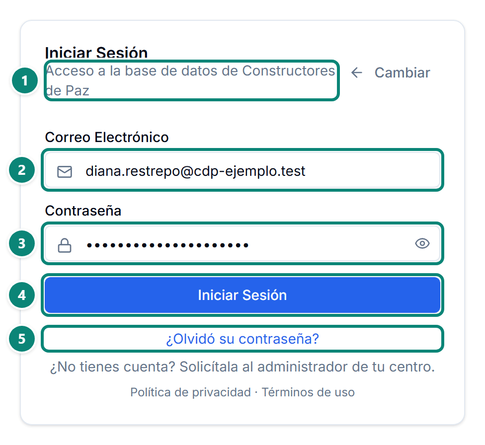

   _Figura 1-2. Formulario de inicio de sesión._
   - ① Centro elegido; con **Cambiar** se vuelve a la selección de centro.
   - ② Correo electrónico.
   - ③ Contraseña.
   - ④ Botón **Iniciar Sesión**.
   - ⑤ Enlace para recuperar la contraseña.

4. Si es tu primer ingreso, el sistema te forzará a **cambiar tu contraseña** antes de continuar.

Si el correo o la contraseña no coinciden, el formulario muestra un mensaje y no deja entrar (ver [Figura 1-3](#figura-1-3)).

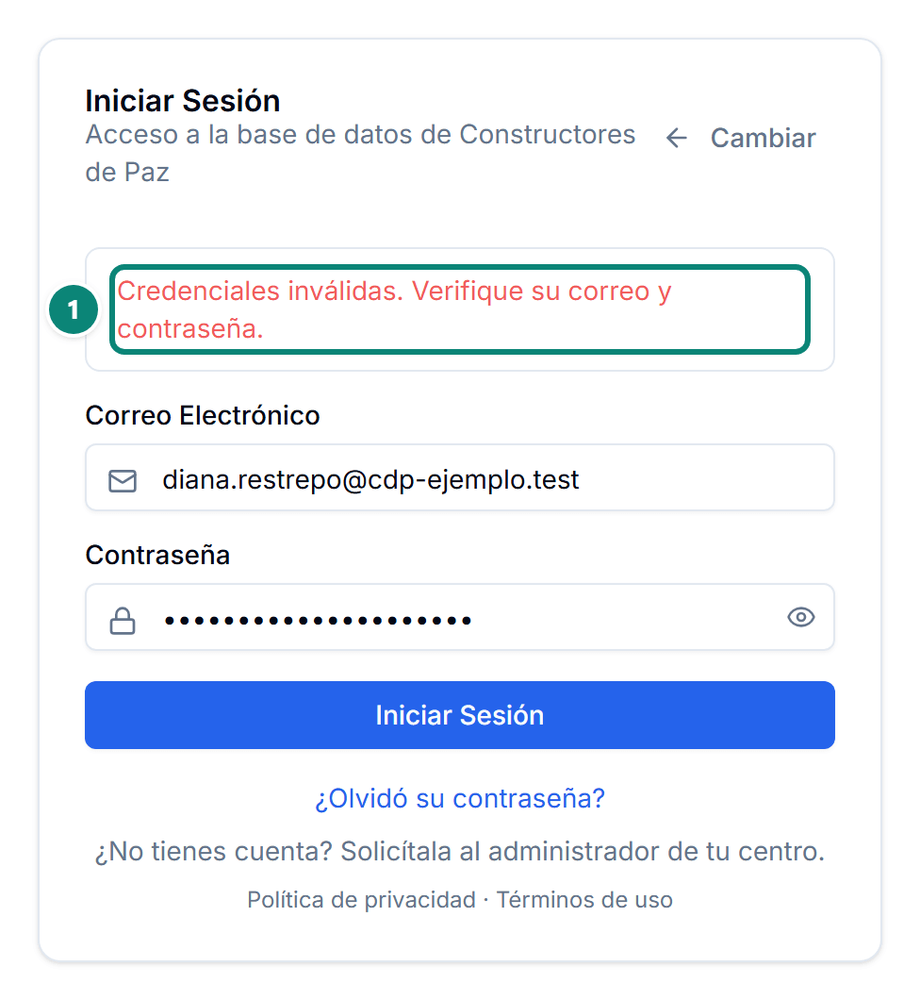

_Figura 1-3. Mensaje cuando el correo o la contraseña no coinciden._

- ① Mensaje de credenciales inválidas.

Mientras la cuenta tenga pendiente fijar su contraseña (ver el paso 4), el formulario tampoco deja entrar y muestra el aviso de la [Figura 1-4](#figura-1-4).

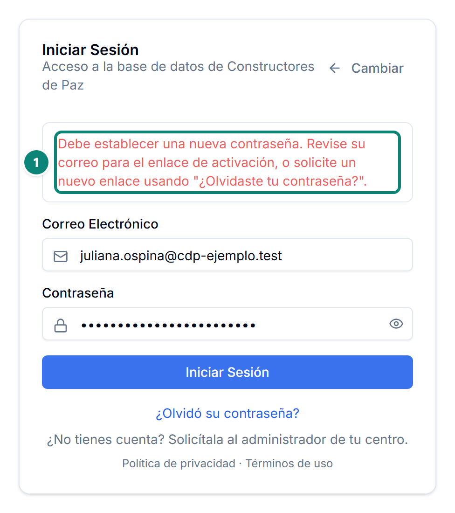

_Figura 1-4. Aviso al ingresar con la contraseña pendiente de fijar._

- ① Aviso: la contraseña se fija desde el enlace del correo o con la recuperación de contraseña.

**Olvidaste tu contraseña:** link "¿Olvidó su contraseña?" envía un email con token válido por 1 hora (ver [Figura 1-5](#figura-1-5)).

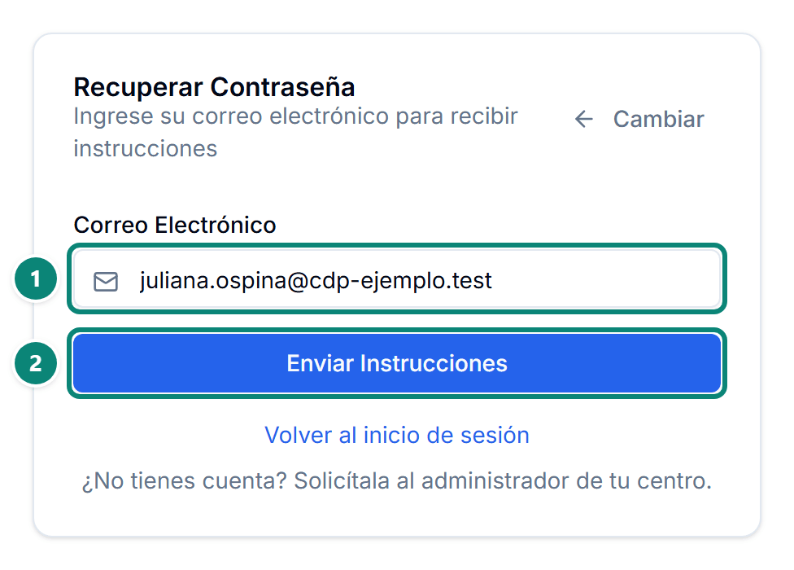

_Figura 1-5. Formulario de recuperación de contraseña._

- ① Correo electrónico de la cuenta.
- ② Botón **Enviar Instrucciones**.

---

## 2. Roles y permisos

Los 6 roles con los que arranca cada centro (`src/prisma/seed.ts`):

| Rol                          | Alcance                                                                                                        |
| ---------------------------- | -------------------------------------------------------------------------------------------------------------- |
| **Administrador**            | Acceso total: casos, usuarios, roles, reportes, auditoría, eliminar casos/deudores/acreedores                  |
| **Operadora de Insolvencia** | Crear y editar casos, acreedores y deudores; generar documentos. No elimina casos ni administra usuarios/roles |
| **Abogado**                  | Crear y editar casos (ve también los casos propios); genera documentos. No elimina nada                        |
| **Asistente Legal**          | Solo consulta de casos (propios y en general) y de acreedores/deudores; genera documentos                      |
| **Secretaria**               | Solo consulta de casos y documentos — sin crear, editar ni generar                                             |
| **Usuario**                  | Consulta de los casos en los que figura como cliente, de deudores, acreedores y documentos; ve notificaciones  |

Los permisos son configurables por rol desde **Usuarios → Roles y Permisos** (ver 10).

---

## 3. Dashboard

Al ingresar verás:

- **Selector de tareas:** accesos a los módulos que tu rol puede usar (ver [Figura 3-1](#figura-3-1)).
- **Indicadores:** total de casos, casos de este mes, audiencias de los próximos 7 días, deuda total y acreedores registrados; cuando hay pagos vencidos, también su número (ver [Figura 3-2](#figura-3-2)).
- **Gráficos:** casos por tipo, casos por fase y casos nuevos de los últimos 6 meses (ver [Figura 3-2](#figura-3-2)).
- **Casos recientes:** los últimos 5 casos ingresados, con su fase (ver [Figura 3-3](#figura-3-3)).
- **Notificaciones:** las más recientes, en el panel de la derecha; la campana de la barra superior indica cuántas hay sin leer (ver [Figura 3-1](#figura-3-1)).

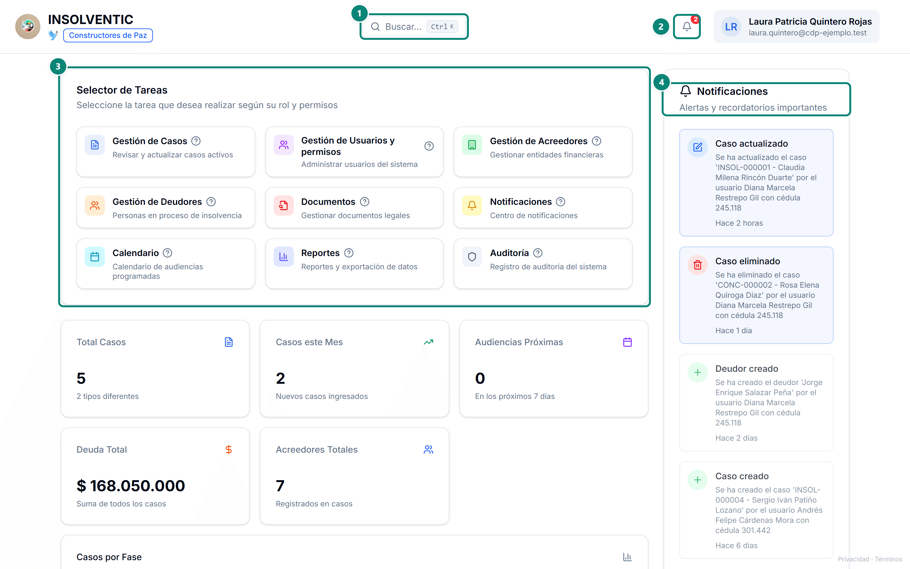

_Figura 3-1. Dashboard de la Administradora: barra superior, selector de tareas y notificaciones._

- ① Búsqueda global.
- ② Campana, con el número de notificaciones sin leer.
- ③ Selector de tareas: un acceso por cada módulo permitido al rol.
- ④ Panel de notificaciones recientes.

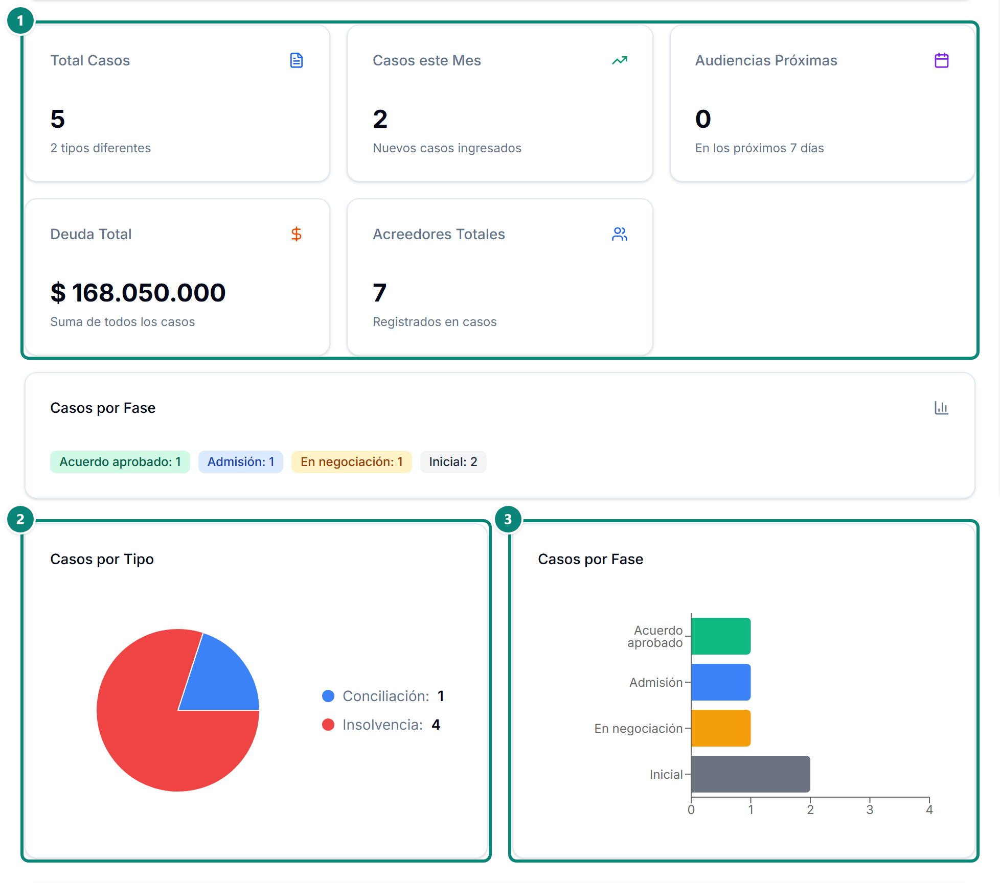

_Figura 3-2. Indicadores y gráficos del dashboard._

- ① Indicadores.
- ② Gráfico de casos por tipo de servicio.
- ③ Gráfico de casos por fase.

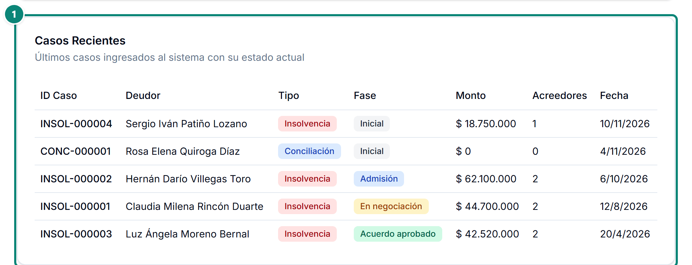

_Figura 3-3. Casos recientes._

- ① Los cinco casos ingresados más recientemente.

El selector de tareas cambia con el rol. La Secretaria, por ejemplo, solo ve **Gestión de Casos** y **Documentos** (ver [Figura 3-4](#figura-3-4)).

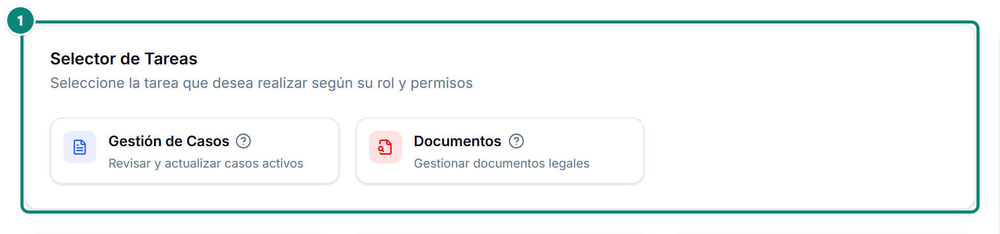

_Figura 3-4. Selector de tareas de la Secretaria._

- ① Solo los módulos que permite su rol.

---

## 4. Gestión de casos

### 4.1 Crear un caso

`Casos → Crear nuevo caso`, y en el menú elegir el tipo de servicio (ver [Figura 4.1-1](#figura-4-1-1)).

_Figura 4.1-1. Botón «Crear nuevo caso» y su menú de tipos de servicio._

- ① Botón **Crear nuevo caso**.
- ② Opción **Insolvencia**.
- ③ Opción **Conciliación**.

El formulario se abre en la pestaña 1; las pestañas se recorren con **Siguiente** o haciendo clic en ellas (ver [Figura 4.1-2](#figura-4-1-2)).

_Figura 4.1-2. Formulario de alta de insolvencia al abrirse, en la pestaña Solicitante._

- ① Las siete pestañas del formulario.
- ② Selector del deudor.
- ③ Botón para crear un deudor nuevo.
- ④ Deuda total, que se calcula a partir de los acreedores.

Si al pulsar **Crear Caso** falta un dato obligatorio, el formulario vuelve a la primera pestaña con errores, marca en rojo las pestañas y los campos que faltan, y un aviso «Campos incompletos» los enumera (ver [Figura 4.1-3](#figura-4-1-3)).

_Figura 4.1-3. Errores de validación al intentar crear el caso sin los datos obligatorios._

- ① Pestaña **Solicitante**, marcada con errores.
- ② Pestaña **Acreedores**, marcada con errores.
- ③ Selector del deudor sin diligenciar.
- ④ Mensaje del campo con error.
- ⑤ Aviso «Campos incompletos» con la lista de lo que falta.

**Pestañas del formulario (insolvencia):**

1. **Solicitante** — deudor (se elige uno existente o se crea con el botón de al lado), causas de la insolvencia, ámbito de aplicación (persona natural no comerciante o pequeño comerciante) y operador del caso. La deuda total se calcula sola a partir de los acreedores (ver [Figura 4.1-4](#figura-4-1-4) y [Figura 4.1-5](#figura-4-1-5)).

   
   

   _Figura 4.1-4. Pestaña Solicitante diligenciada: deudor, ficha, deuda total y causas._
   - ① Deudor seleccionado.
   - ② Ficha con los datos del deudor.
   - ③ Deuda total, calculada desde los acreedores.
   - ④ Causas de la insolvencia.

   
   

   _Figura 4.1-5. Ámbito de aplicación y operador del caso._
   - ① Ámbito de aplicación.
   - ② Operador del caso; recibe las alertas de audiencia y de pago vencido del expediente.

2. **Situación** — cónyuge o compañero(a) permanente (sociedad conyugal vigente/disuelta), información laboral y económica (ingresos, gastos, recursos disponibles, obligaciones alimentarias), cesación de pagos y procesos judiciales en curso (ver [Figura 4.1-6](#figura-4-1-6)).

   
   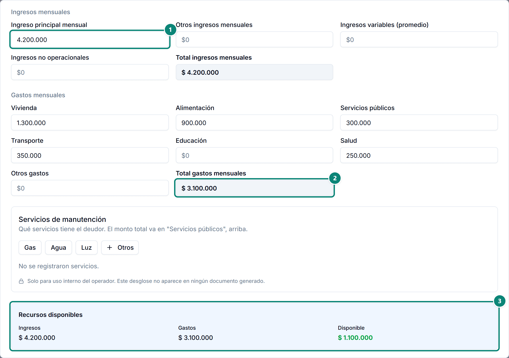

   _Figura 4.1-6. Ingresos, gastos y recursos disponibles del deudor._
   - ① Ingreso principal mensual.
   - ② Total de gastos mensuales, calculado.
   - ③ Recursos disponibles (ingresos menos gastos), base de la cuota de la propuesta.

3. **Acreedores** — acreedores y deudas: capital, intereses, tasa y tipo de deuda; la clasificación del crédito, la clase y el % de acreencia se calculan solos. Incluye también libranzas y servicios públicos suspendidos (ver [Figura 4.1-7](#figura-4-1-7)).

   
   

   _Figura 4.1-7. Datos de un acreedor y su deuda._
   - ① Nombre del acreedor.
   - ② Capital de la deuda, con separador de miles.
   - ③ Tipo de deuda.
   - ④ Clase, calculada según el tipo de deuda.

4. **Bienes** — muebles, inmuebles, vehículos, con avalúo.
5. **Propuesta** — resumen de obligaciones por clase y flujo de caja (cuota mensual y plazo), que se calculan con los datos de las pestañas 2 y 3; período de gracia, dación en pago, quitas, condonación de intereses y orden de prelación (ver [Figura 4.1-8](#figura-4-1-8)).

   
   

   _Figura 4.1-8. Resumen por clase y flujo de caja calculados._
   - ① Total de obligaciones.
   - ② Cuota mensual propuesta.
   - ③ Plazo estimado.

6. **Legal** — declaraciones (veracidad, buena fe, no ocultamiento, autorizaciones), tarifa y fundamentos de derecho, notificaciones, apoderado y firma del solicitante.
7. **Documentos** — carga de los documentos del caso (ver el párrafo siguiente).

**Documentos del caso:** PDF, JPG o PNG, máx. 4 MB por archivo, en la pestaña de documentos del formulario, al crear o al editar el caso. No hay límite para el total. Un archivo más pesado se rechaza al elegirlo; un PDF comprimido o una foto en menor resolución suelen caber. Si alguno no se puede subir al guardar, los demás quedan guardados y un aviso dice cuál falló y por qué; se vuelve a adjuntar desde **Editar caso → Documentos**.

La [Figura 4.1-9](#figura-4-1-9) muestra la pestaña con un archivo rechazado por tamaño.

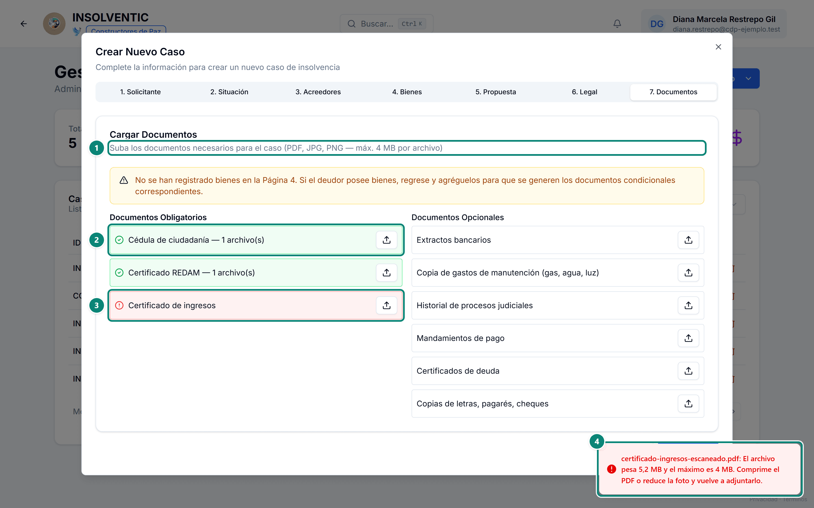

_Figura 4.1-9. Carga de documentos, con un archivo rechazado por tamaño._

- ① Formatos admitidos y tamaño máximo por archivo.
- ② Documento obligatorio cargado.
- ③ Documento obligatorio pendiente.
- ④ Aviso de rechazo, con el peso del archivo.

Con todo completo, **Crear Caso** guarda el expediente y el caso aparece en el listado con su número (ver [Figura 4.1-10](#figura-4-1-10)).

_Figura 4.1-10. El caso recién creado en el listado de casos._

- ① Caso nuevo, con el número que le asignó el sistema.

**Para un caso de Conciliación**, el formulario cambia a tres pestañas
(Solicitante, Partes y Solicitud): asunto y cuantía,
audiencia virtual (Zoom: ID, código de acceso, enlace), convocante/convocado
y sus apoderados, fechas reales del trámite (solicitud, citación,
desistimiento), menores de edad (alimentos/unión marital), cláusulas del
acuerdo, causa de terminación anormal, resultado del informe del
conciliador, y — si aplica el trámite — los datos de la Aclaración de Acta
(qué campo tenía el error, valor incorrecto/correcto) y de las referencias
del acta de unión marital que se disuelve o aclara (ver [Figura 4.1-11](#figura-4-1-11) y [Figura 4.1-12](#figura-4-1-12)).

_Figura 4.1-11. Conciliación: pestaña Partes._

- ① Las tres pestañas de la conciliación.
- ② Datos del convocado (contraparte).
- ③ Apoderado del convocante.
- ④ Apoderado del convocado.

_Figura 4.1-12. Conciliación: pestaña Solicitud._

- ① Asunto y cuantía.
- ② Fechas reales del trámite.
- ③ Audiencia virtual (Zoom).

Si cierra el diálogo antes de pulsar **Crear Caso** (con **Cancelar**, la X,
la tecla Esc o un clic fuera del diálogo), los datos ingresados no se
conservan: el sistema no pide confirmación y el formulario vuelve a abrirse
vacío.

**Montos en pesos:** todo campo de dinero (ingresos, gastos, deudas,
cuantía) muestra el separador de miles mientras se escribe —`1.500.000`, no
`1500000`— para que sea más fácil verificar que el monto es el correcto (ver
[Figura 4.1-6](#figura-4-1-6) y [Figura 4.1-7](#figura-4-1-7)).

### 4.2 Filtrar y buscar casos

En el listado (ver [Figura 4.2-1](#figura-4-2-1)) puedes filtrar por:

- Texto libre (número de caso, nombre del deudor, cédula)
- **Tipo de servicio** (Insolvencia / Conciliación / Acuerdo de Apoyo)
- Fase (cualquiera de las 13 fases del expediente; ver [Figura 4.2-2](#figura-4-2-2) y 4.4)

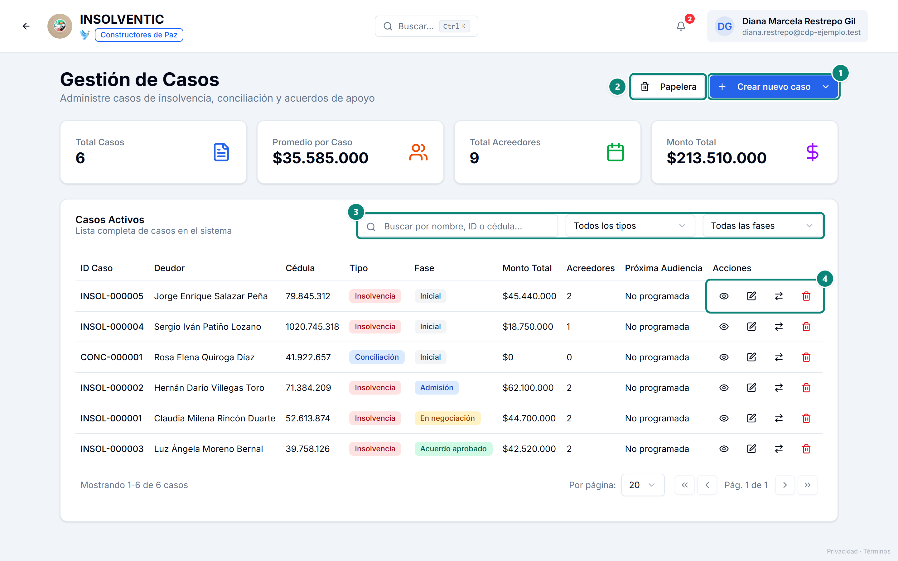

_Figura 4.2-1. Listado de casos._

- ① Botón **Crear nuevo caso**.
- ② Botón **Papelera**.
- ③ Búsqueda y filtros por tipo de servicio y por fase.
- ④ Acciones del caso: ver, editar, cambiar fase y eliminar.

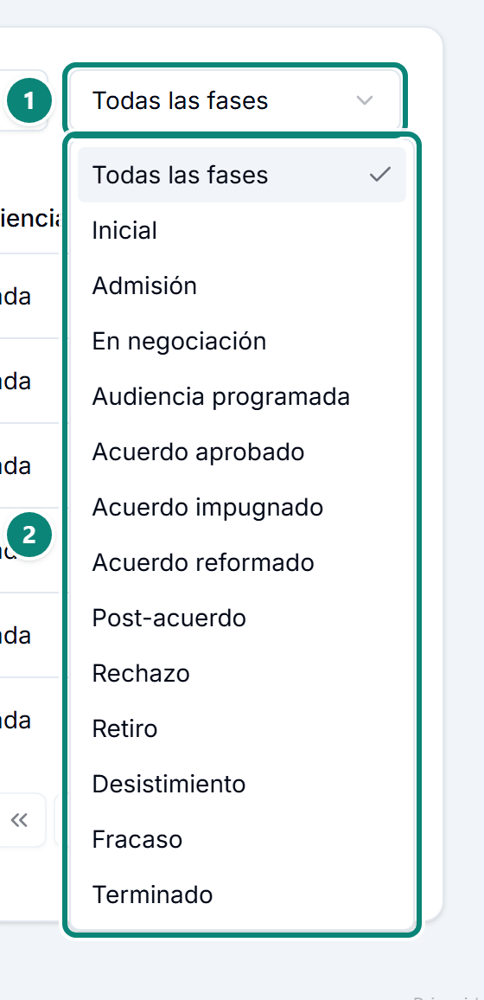

_Figura 4.2-2. Filtro de fase desplegado._

- ① Filtro de fase.
- ② Las 13 fases del expediente.

### 4.3 Editar un caso

Abrir el caso → **Editar**. El sistema protege contra ediciones concurrentes:

> ⚠️ **Si dos usuarios editan el mismo caso al tiempo**, quien guarde último recibirá el mensaje _"Este caso fue modificado por otro usuario. Recargue y vuelva a intentarlo."_ — el dialog se cerrará automáticamente.

El diálogo **Editar Caso** reparte los datos en pestañas numeradas (ver [Figura 4.3-1](#figura-4-3-1)); los cambios se guardan con **Guardar Cambios**, al pie del diálogo.

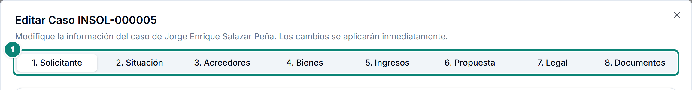

_Figura 4.3-1. Diálogo de edición de un caso de insolvencia._

- ① Pestañas con los datos del caso.

### 4.3.1 Eliminar y restaurar un caso (papelera)

**Eliminar** un caso lo manda a la **papelera**: deja de aparecer en listados, búsquedas, reportes, alertas, pagos y documentos, pero no se pierde nada. Hay que escribir el número del caso para confirmar (ver [Figura 4.3.1-1](#figura-4-3-1-1)).

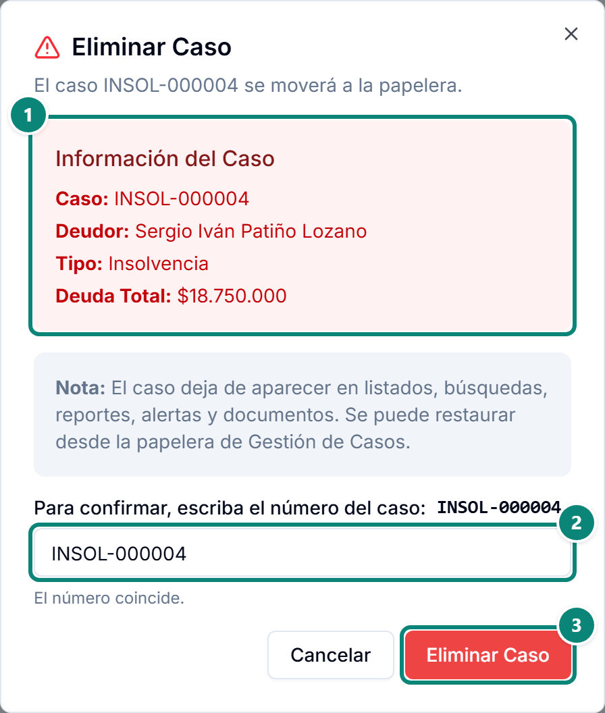

_Figura 4.3.1-1. Confirmación para mandar un caso a la papelera._

- ① Datos del caso que se va a eliminar.
- ② Número del caso, escrito para confirmar.
- ③ Botón **Eliminar Caso**.

<!-- La leyenda de arriba y la lista de abajo son listas distintas. -->

- **Ver la papelera y restaurar:** botón **Papelera** en Gestión de Casos. Lo ve quien puede eliminar casos (Administrador y Operadora de Insolvencia). **Restaurar** devuelve el caso tal como estaba (ver [Figura 4.3.1-2](#figura-4-3-1-2)).

  
  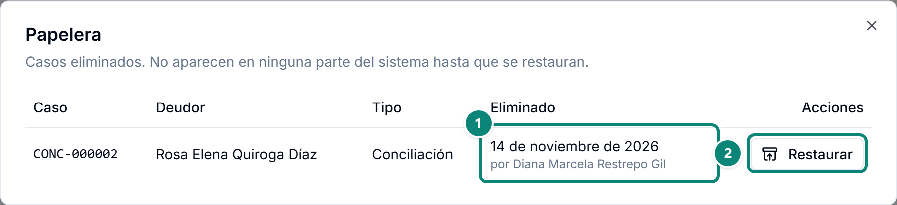

  _Figura 4.3.1-2. Papelera vista por la Operadora: solo puede restaurar._
  - ① Fecha de eliminación y usuario que eliminó el caso.
  - ② Botón **Restaurar**.

- **Eliminar definitivamente:** solo el **Administrador**, desde la papelera, escribiendo de nuevo el número del caso. Borra el caso y todo lo asociado y **no se puede deshacer**. Úselo solo cuando corresponda una supresión de datos (ver el procedimiento de derechos ARCO). Ver [Figura 4.3.1-3](#figura-4-3-1-3) y [Figura 4.3.1-4](#figura-4-3-1-4).

  
  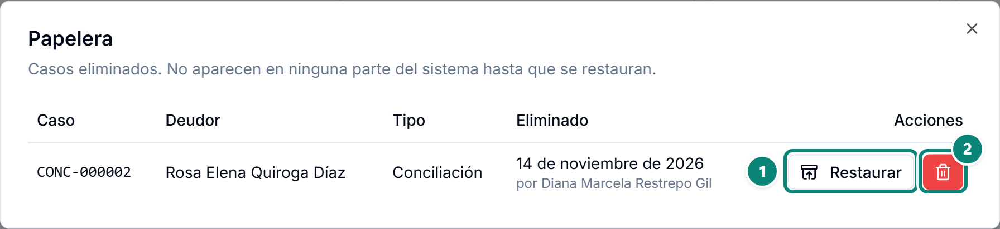

  _Figura 4.3.1-3. Papelera vista por la Administradora._
  - ① Botón **Restaurar**.
  - ② Botón para eliminar el caso definitivamente.

  
  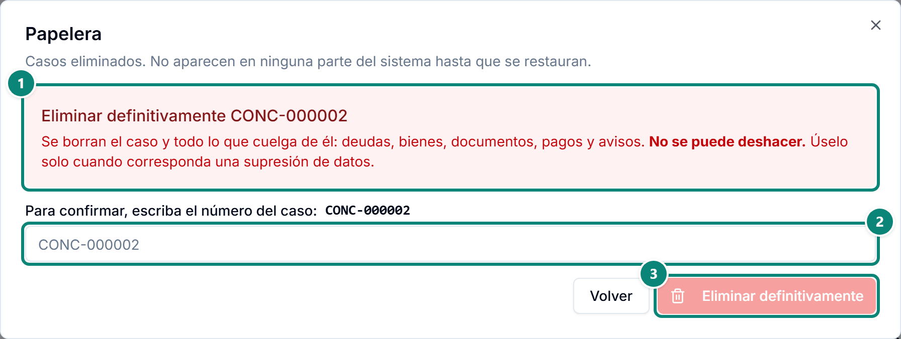

  _Figura 4.3.1-4. Confirmación del borrado definitivo._
  - ① Advertencia: el borrado no se puede deshacer.
  - ② Número del caso, escrito de nuevo para confirmar.
  - ③ Botón **Eliminar definitivamente**; se activa solo cuando el número coincide.

- Un **deudor** que tenga casos (incluidos los de la papelera) no se puede eliminar: primero hay que eliminar sus casos.

### 4.4 Transiciones de fase

El expediente tiene 13 fases (`Inicial` → `Terminado`). La fase se cambia
desde el listado, con la acción **Cambiar fase** de cada caso: el diálogo
muestra la fase actual y solo las transiciones **válidas desde ella** — el
sistema no deja saltar fases (ver [Figura 4.4-1](#figura-4-4-1)).

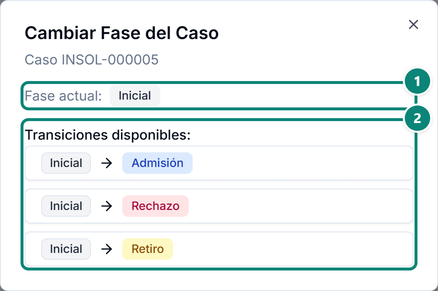

_Figura 4.4-1. Transiciones válidas desde la fase Inicial._

- ① Fase actual del caso.
- ② Transiciones disponibles desde esa fase.

**Las 5 fases que distinguen el desenlace de la negociación**, en vez de
caer todas a `Fracaso` con el mismo paquete de documentos:

| Fase                  | Cuándo se usa                                                                                                   |
| --------------------- | --------------------------------------------------------------------------------------------------------------- |
| **Rechazo**           | La solicitud se rechaza de entrada, antes de admitir — no es un fracaso de negociación                          |
| **Retiro**            | El solicitante se retira **antes** de que el caso sea admitido                                                  |
| **Desistimiento**     | El deudor abandona el trámite **después** de admitido. Pide un subtipo: _No pago de tarifas_ o _Abandono total_ |
| **Acuerdo impugnado** | Hay una impugnación pendiente ante el juez sobre un acuerdo ya aprobado                                         |
| **Acuerdo reformado** | El juez ordena corregir el acuerdo y se corrige dentro del plazo                                                |

**Fracaso** (la fase que ya existía) pide un subtipo de entre 13 — por
ejemplo _Inasistencia del deudor_, _Incumplimiento_, _Impugnación del
acuerdo_, _Muerte del deudor_ — porque cada uno genera un paquete de
documentos distinto.

Al elegir **Fracaso** o **Desistimiento**, el diálogo pide el subtipo y la
fecha antes de confirmar el cambio (ver [Figura 4.4-2](#figura-4-4-2)). Las
demás transiciones se aplican al elegirlas.

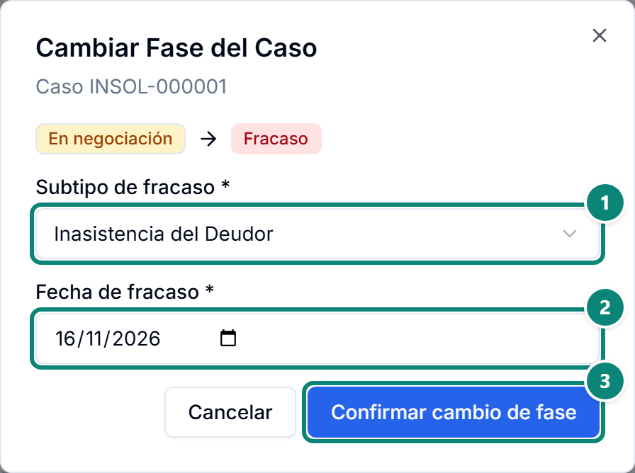

_Figura 4.4-2. Paso a Fracaso: subtipo y fecha obligatorios._

- ① Subtipo de fracaso.
- ② Fecha del fracaso.
- ③ Botón **Confirmar cambio de fase**.

Cada transición queda registrada en el **Audit Log**.

> `Rechazo`, `Retiro`, `Acuerdo impugnado` y `Acuerdo reformado` todavía no
> tienen su propio paquete de documentos (pendiente del abogado, ver
> `docs/DISENO_FASES_NUEVAS_2026-09-11.md` §3) — hoy, al generar documentos
> para un caso en una de esas 4 fases, el sistema usa el Paquete 1 por
> defecto.

---

## 5. Deudores, acreedores, apoderados

Módulos independientes con CRUD. Al crear un caso puedes vincular un deudor existente o crear uno nuevo al vuelo.

Las listas de deudores y de acreedores tienen búsqueda, un filtro, exportación y las acciones de cada fila (ver [Figura 5-1](#figura-5-1) y [Figura 5-3](#figura-5-3)). El alta de un deudor se diligencia en tres pestañas: Personal, Financiero y Contacto (ver [Figura 5-2](#figura-5-2)).

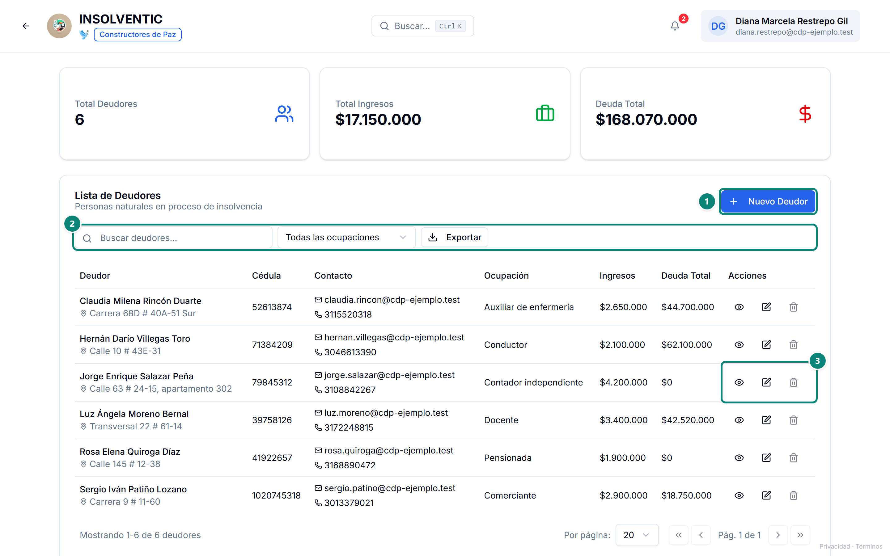

_Figura 5-1. Lista de deudores._

- ① Botón **Nuevo Deudor**.
- ② Búsqueda, filtro por ocupación y exportación.
- ③ Acciones del deudor: ver, editar y eliminar (esta última, solo con el permiso).

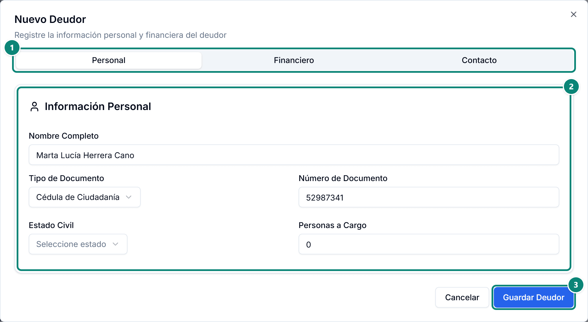

_Figura 5-2. Alta de un deudor._

- ① Pestañas Personal, Financiero y Contacto.
- ② Datos personales del deudor.
- ③ Botón **Guardar Deudor**.

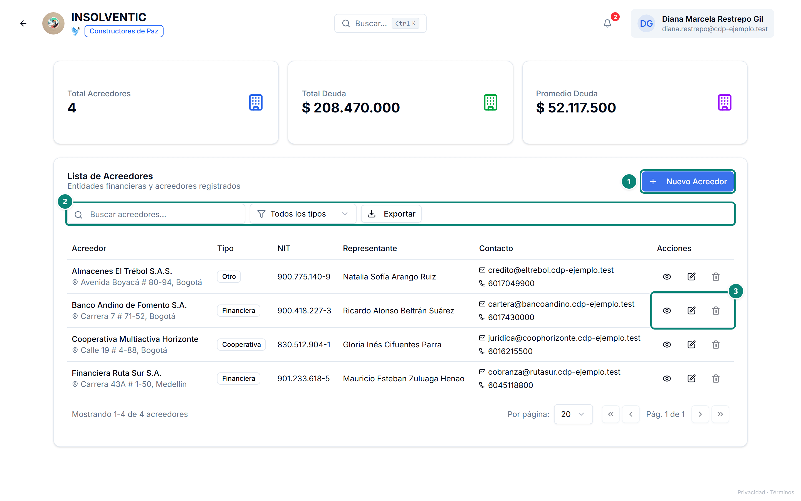

_Figura 5-3. Lista de acreedores._

- ① Botón **Nuevo Acreedor**.
- ② Búsqueda, filtro por tipo y exportación.
- ③ Acciones del acreedor: ver, editar y eliminar (esta última, solo con el permiso).

**En conciliación:** hay dos roles — **Convocante** (solicitante) y **Convocado** (contraparte). Se gestionan como acreedores bilaterales.

---

## 6. Generación de documentos

Módulo **Documentos**, tarjeta **Generación de Documentos**:

1. **Seleccionar caso.**
2. **Seleccionar paquete** — el número de documentos de cada opción se
   calcula en vivo contra las plantillas reales, así que puede variar si se
   agrega o quita una plantilla:
   - Todos los paquetes
   - Paquete 1 — Solicitud
   - Paquete 2 — Admisión y Apertura
   - Paquete 3 — Negociación y Acuerdo
   - Paquete 4 — Terminación Normal
   - Paquete 5 — Fracaso

   Ver [Figura 6-1](#figura-6-1).

   
   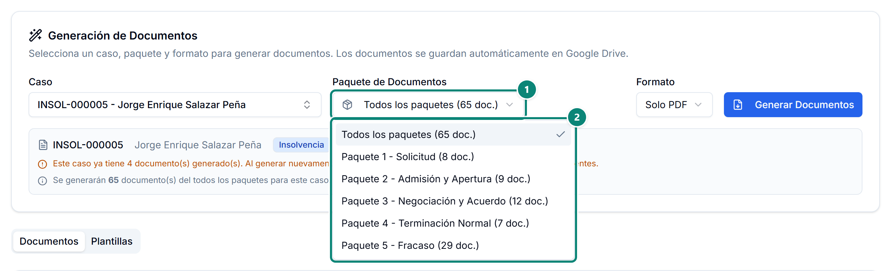

   _Figura 6-1. Lista de paquetes, con el número de documentos de cada uno._
   - ① Selector de paquete.
   - ② Paquetes disponibles.

3. **Seleccionar formato:** Solo PDF / Solo Word / Ambos.
4. **Generar documentos** (ver [Figura 6-2](#figura-6-2)).

   
   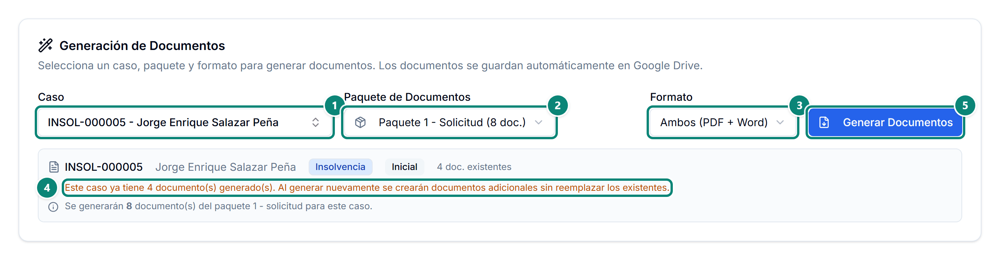

   _Figura 6-2. Formulario completo antes de generar._
   - ① Caso.
   - ② Paquete.
   - ③ Formato.
   - ④ Aviso: el caso ya tiene documentos generados.
   - ⑤ Botón **Generar Documentos**.

**Lotes grandes (Todos los paquetes, o Paquete 5) se generan por tandas.**
El botón muestra _"Generando tanda X de Y..."_ mientras corre — es normal
que un lote grande tarde más que uno chico, y no se puede volver a hacer
clic hasta que termine. Si una tanda falla a mitad de camino (por ejemplo,
un corte de red), las tandas que ya terminaron **no se pierden**: aparece
un botón **"Reintentar"** que retoma solo la tanda que faltó, no el lote
completo desde el principio.

El sistema:

- Valida que el caso tenga los campos requeridos (muestra faltantes).
- Sube automáticamente los archivos a la carpeta del caso en **Google Drive**.
- Guarda un registro en la pestaña _Documentos_ del caso con link directo.
- Usa el membrete y la firma propios del centro de conciliación del caso
  (logo, nombre del centro, firma de la conciliadora) — cada centro ve sus
  documentos con su propia identidad, no una genérica.

**Alertas que puedes ver:**

- ⚠️ _Este caso ya tiene N documentos generados. Al generar nuevamente se crearán adicionales sin reemplazar los existentes._ (ver [Figura 6-2](#figura-6-2))
- ❌ _Error leyendo plantilla:_ significa que la plantilla base tiene un problema — contacta a soporte.
- ⚠️ _No se generó por datos incompletos:_ el documento se salta (no cuenta como error) porque al caso le falta un dato obligatorio para esa plantilla — complétalo y vuelve a generar.

---

## 7. Vista de documentos del caso

En el detalle del caso (acción **Ver detalles** del listado) → pestaña **8. Documentos**:

- **Estado de Documentos:** si el caso ya tiene carpeta en Google Drive (con el botón **Abrir carpeta** cuando existe) y cuántos documentos se han generado.
- **Generar Documentos por Etapa:** un botón por paquete (Solicitud, Admisión, Acuerdo y Fracaso); cada paquete indica los datos que le faltan antes de poder generarlo.
- **Documentos Generados:** la lista de documentos del caso; **Ver** abre el documento en una pestaña nueva.

Los documentos del caso se suben desde **Editar** → pestaña **8. Documentos** (ver 4.3).

---

## 8. Trazabilidad de pagos

### 8.1 Generar cronograma

En la pestaña **Pagos** del caso, botón **"Generar Cronograma de Pagos"** crea las cuotas según la propuesta de pago del caso (plazo, periodicidad y fecha de inicio) (ver [Figura 8.1-1](#figura-8-1-1)).

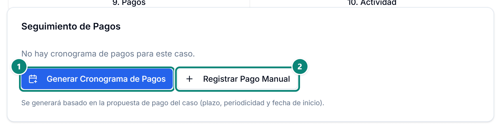

_Figura 8.1-1. Caso sin cronograma de pagos._

- ① Botón **Generar Cronograma de Pagos**.
- ② Botón **Registrar Pago Manual**.

Con el cronograma creado, la pestaña muestra el resumen y cada cuota con su estado (ver [Figura 8.1-2](#figura-8-1-2)).

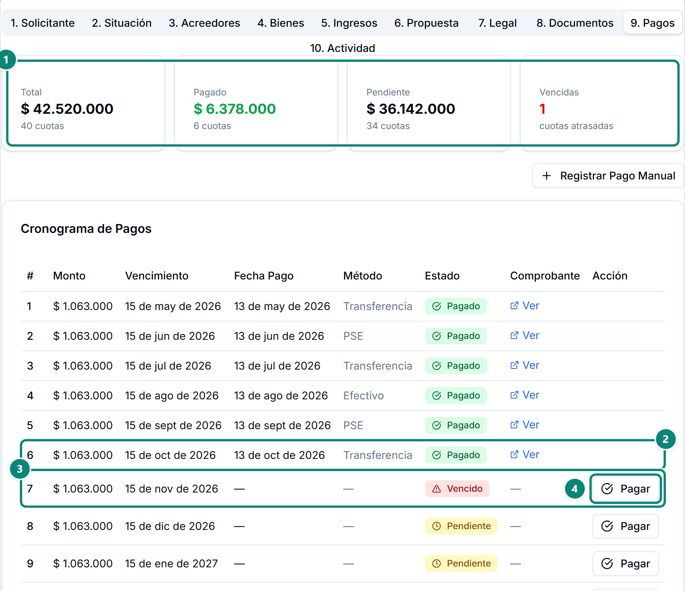

_Figura 8.1-2. Cronograma de pagos de un acuerdo en curso._

- ① Resumen: total, pagado, pendiente y cuotas vencidas.
- ② Cuota pagada, con su comprobante.
- ③ Cuota vencida.
- ④ Botón **Pagar** de la cuota.

### 8.2 Registrar un pago

Botón **"Registrar Pago Manual"** (o **"Pagar"** en una cuota del cronograma):

- Monto
- Fecha de pago (solo en el registro manual; al pagar una cuota se registra la fecha del día)
- Método (Transferencia, Efectivo, Cheque, PSE, Otro)
- Observaciones
- **Comprobante** (PDF / JPG / PNG, máx. 4 MB)

Ver [Figura 8.2-1](#figura-8-2-1).

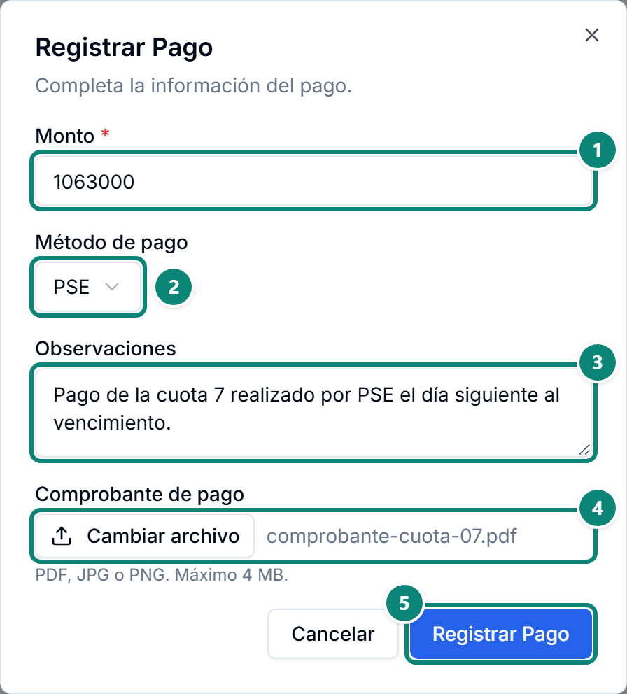

_Figura 8.2-1. Pago de una cuota del cronograma._

- ① Monto.
- ② Método de pago.
- ③ Observaciones.
- ④ Comprobante.
- ⑤ Botón **Registrar Pago**.

El comprobante se sube automáticamente a `{caso}/Comprobantes/` en Drive. Si el archivo pesa más de 4 MB, el formulario lo rechaza al elegirlo y dice cuánto pesa; una foto o un PDF escaneado suelen bajar de ese tamaño comprimiéndolos o guardándolos en menor resolución (ver [Figura 8.2-2](#figura-8-2-2)).

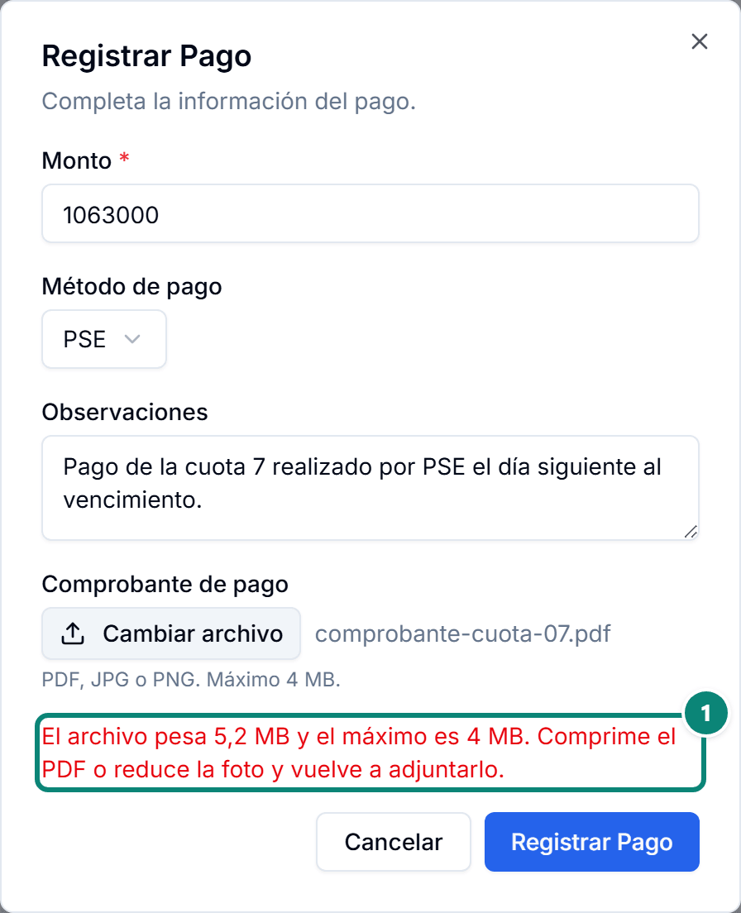

_Figura 8.2-2. Comprobante rechazado por tamaño._

- ① Mensaje con el peso del archivo y el máximo permitido.

### 8.3 Estados de pago

| Estado      | Significado                                                                                        |
| ----------- | -------------------------------------------------------------------------------------------------- |
| `pendiente` | Cuota programada, sin pago registrado                                                              |
| `pagado`    | Pago registrado (aunque el monto sea menor al de la cuota)                                         |
| `parcial`   | Existe como estado, pero hoy ninguna acción lo asigna: registrar un pago deja la cuota en `pagado` |
| `vencido`   | Fecha de vencimiento superada sin pago                                                             |

### 8.4 Reporte de trazabilidad

`Reportes → Trazabilidad de Pagos`:

- Filtros: estado, fechas, tiene comprobante, búsqueda.
- Summaries: total recaudado, pendiente, vencido, casos con pagos.
- Tabla expandible por caso con barra de progreso `pagado / obligación total`.

---

## 9. Reportes

| Reporte                   | Contenido                                                          |
| ------------------------- | ------------------------------------------------------------------ |
| **Estado de Casos**       | Distribución por tipo, fase, operador. Montos solo en Insolvencia. |
| **Trazabilidad de Pagos** | Ver sección 8.4                                                    |

Los dos reportes se exportan a Excel (.xlsx) con el botón **Exportar Excel**.

---

## 10. Gestión de usuarios y roles

`Usuarios` (permiso requerido; ver [Figura 10-1](#figura-10-1) y [Figura 10-2](#figura-10-2)):

- Crear usuario: nombre completo, correo electrónico, teléfono, tarjeta profesional, dirección y rol (obligatorios: nombre, correo y rol). El sistema genera una contraseña segura y la envía por correo electrónico al usuario.
- Asignar rol.

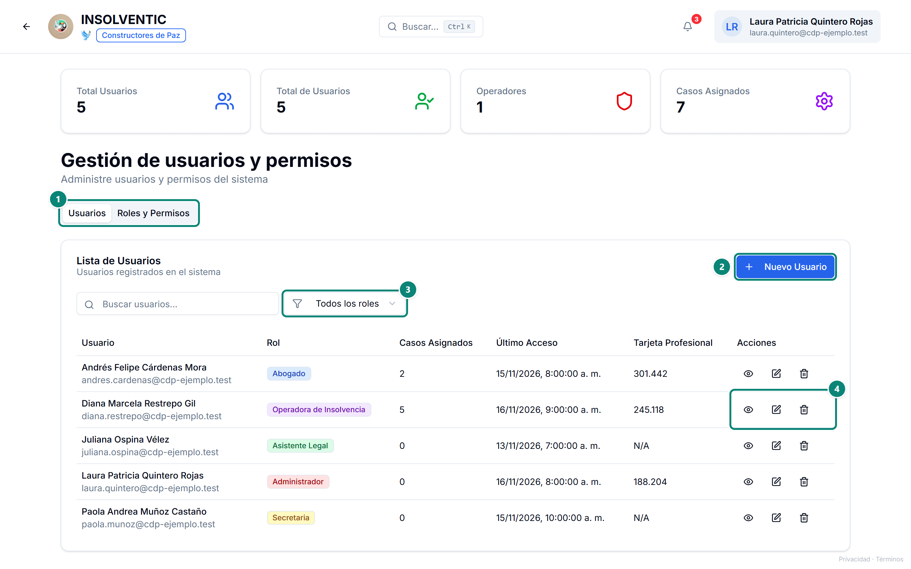

_Figura 10-1. Lista de usuarios._

- ① Pestañas **Usuarios** y **Roles y Permisos**.
- ② Botón **Nuevo Usuario**.
- ③ Filtro por rol.
- ④ Acciones del usuario: ver, editar y eliminar.

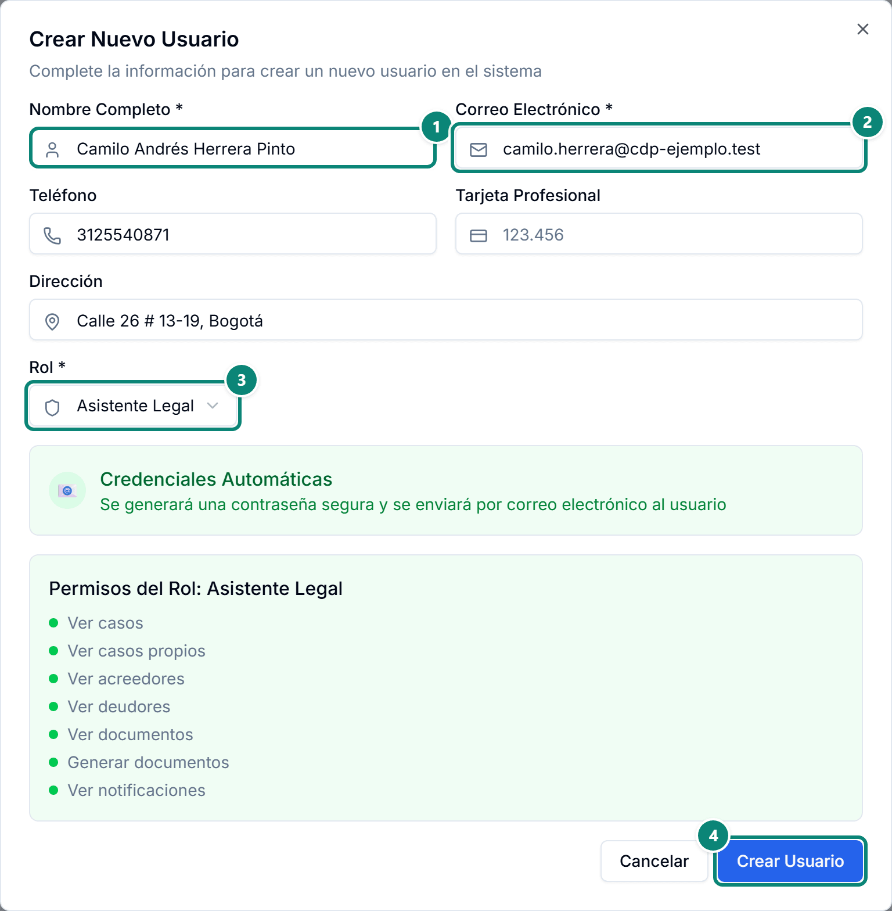

_Figura 10-2. Alta de un usuario._

- ① Nombre completo.
- ② Correo electrónico.
- ③ Rol, con sus permisos debajo.
- ④ Botón **Crear Usuario**.

`Usuarios → Roles y Permisos` (ver [Figura 10-3](#figura-10-3) y [Figura 10-4](#figura-10-4)):

- Crear rol nuevo.
- Marcar permisos por módulo.

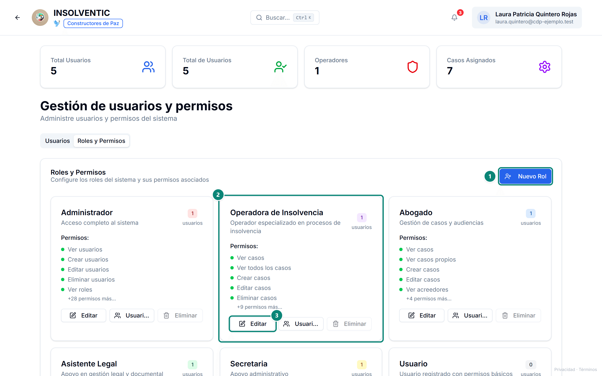

_Figura 10-3. Roles del centro y sus permisos._

- ① Botón **Nuevo Rol**.
- ② Tarjeta del rol, con algunos de sus permisos.
- ③ Botón **Editar** del rol.

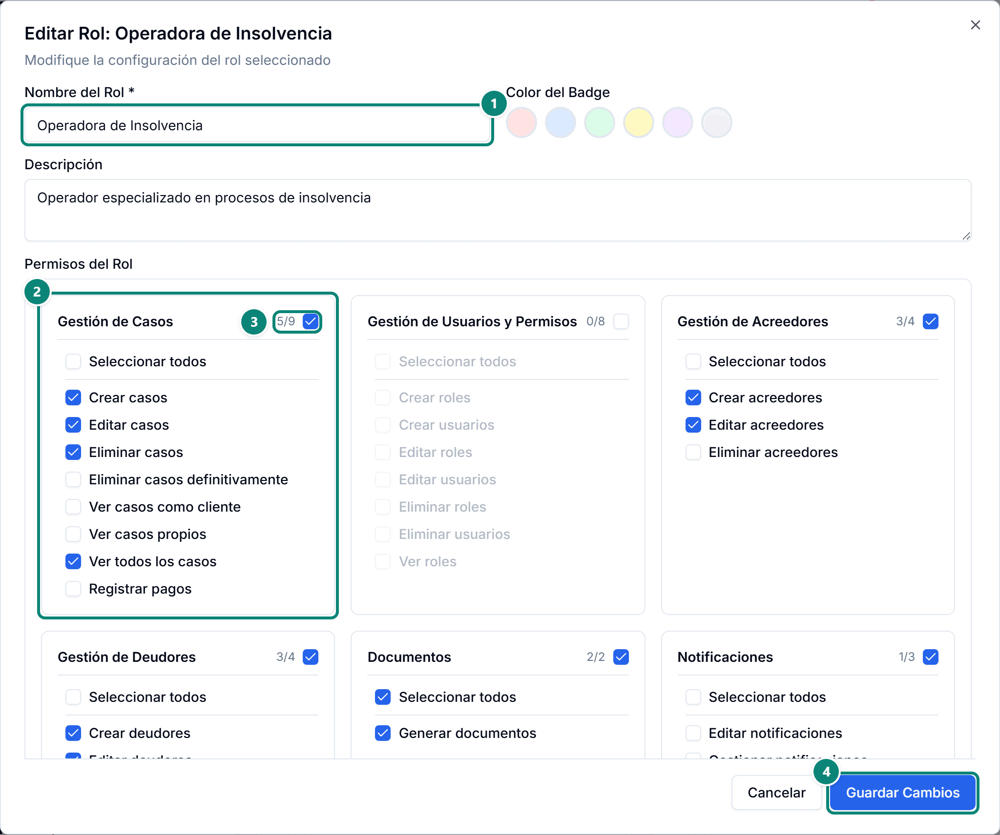

_Figura 10-4. Permisos de un rol, agrupados por módulo._

- ① Nombre del rol.
- ② Módulo de permisos.
- ③ Permisos marcados del módulo y casilla para marcarlo entero.
- ④ Botón **Guardar Cambios**.

---

## 11. Auditoría

`Auditoría` (permiso requerido): bitácora cronológica de acciones críticas:

- Login / logout
- Creación, edición, eliminación de casos/deudores/acreedores
- Cambios de fase
- Generación de documentos
- Registro de pagos
- Cambios de rol/permisos

Filtrable por texto (nombre o usuario), tipo de entidad, acción, usuario y rango de fechas.

---

## 12. Notificaciones

Icono de campana en la barra superior muestra notificaciones internas. Dos fuentes:

**Eventos del sistema (tiempo real):**

- Caso creado / actualizado / eliminado
- Acreedor, deudor, usuario, rol (alta/modificación/baja)

**Alertas proactivas (se generan automáticamente cada día a las 08:00 UTC):**

- **Audiencia próxima** (ícono calendario, ámbar): aparece 48h antes de la fecha de audiencia del caso que tengas asignado.
- **Pago vencido** (ícono triángulo, rojo): aparece cuando un pago programado pasa su fecha límite sin registrarse. El estado del pago pasa automáticamente a "vencido".

Al hacer click se marcan como leídas. Si tu administrador activa `ALERTS_EMAIL_ENABLED`, también recibirás un correo.

---

## 13. Preguntas frecuentes

**¿Por qué no puedo editar un caso?**

- Puede estar cerrado (`resultDate` ya fijado).
- No tienes el permiso "Editar casos".
- Tu rol solo tiene permiso "Ver casos".

**El documento generado dice "Error leyendo plantilla":**
Contacta a soporte. La plantilla HTML base puede estar dañada o faltar.

**Subí un comprobante pero no aparece el link:**
Google Drive puede tardar unos segundos en propagar permisos. Recarga la pestaña.

**¿Puedo recuperar un caso eliminado?**
Sí, mientras esté en la papelera: botón **Papelera** en Gestión de Casos → **Restaurar** (ver 4.3.1). Un caso eliminado definitivamente ya no se puede recuperar desde la aplicación; contacta a un administrador — la auditoría conserva evidencia.

---

## Índice de figuras

- [Figura 1-1](#figura-1-1). Selección del centro de conciliación.
- [Figura 1-2](#figura-1-2). Formulario de inicio de sesión.
- [Figura 1-3](#figura-1-3). Mensaje cuando el correo o la contraseña no coinciden.
- [Figura 1-4](#figura-1-4). Aviso al ingresar con la contraseña pendiente de fijar.
- [Figura 1-5](#figura-1-5). Formulario de recuperación de contraseña.
- [Figura 3-1](#figura-3-1). Dashboard de la Administradora: barra superior, selector de tareas y notificaciones.
- [Figura 3-2](#figura-3-2). Indicadores y gráficos del dashboard.
- [Figura 3-3](#figura-3-3). Casos recientes.
- [Figura 3-4](#figura-3-4). Selector de tareas de la Secretaria.
- [Figura 4.1-1](#figura-4-1-1). Botón «Crear nuevo caso» y su menú de tipos de servicio.
- [Figura 4.1-2](#figura-4-1-2). Formulario de alta de insolvencia al abrirse, en la pestaña Solicitante.
- [Figura 4.1-3](#figura-4-1-3). Errores de validación al intentar crear el caso sin los datos obligatorios.
- [Figura 4.1-4](#figura-4-1-4). Pestaña Solicitante diligenciada: deudor, ficha, deuda total y causas.
- [Figura 4.1-5](#figura-4-1-5). Ámbito de aplicación y operador del caso.
- [Figura 4.1-6](#figura-4-1-6). Ingresos, gastos y recursos disponibles del deudor.
- [Figura 4.1-7](#figura-4-1-7). Datos de un acreedor y su deuda.
- [Figura 4.1-8](#figura-4-1-8). Resumen por clase y flujo de caja calculados.
- [Figura 4.1-9](#figura-4-1-9). Carga de documentos, con un archivo rechazado por tamaño.
- [Figura 4.1-10](#figura-4-1-10). El caso recién creado en el listado de casos.
- [Figura 4.1-11](#figura-4-1-11). Conciliación: pestaña Partes.
- [Figura 4.1-12](#figura-4-1-12). Conciliación: pestaña Solicitud.
- [Figura 4.2-1](#figura-4-2-1). Listado de casos.
- [Figura 4.2-2](#figura-4-2-2). Filtro de fase desplegado.
- [Figura 4.3-1](#figura-4-3-1). Diálogo de edición de un caso de insolvencia.
- [Figura 4.3.1-1](#figura-4-3-1-1). Confirmación para mandar un caso a la papelera.
- [Figura 4.3.1-2](#figura-4-3-1-2). Papelera vista por la Operadora: solo puede restaurar.
- [Figura 4.3.1-3](#figura-4-3-1-3). Papelera vista por la Administradora.
- [Figura 4.3.1-4](#figura-4-3-1-4). Confirmación del borrado definitivo.
- [Figura 4.4-1](#figura-4-4-1). Transiciones válidas desde la fase Inicial.
- [Figura 4.4-2](#figura-4-4-2). Paso a Fracaso: subtipo y fecha obligatorios.
- [Figura 5-1](#figura-5-1). Lista de deudores.
- [Figura 5-2](#figura-5-2). Alta de un deudor.
- [Figura 5-3](#figura-5-3). Lista de acreedores.
- [Figura 6-1](#figura-6-1). Lista de paquetes, con el número de documentos de cada uno.
- [Figura 6-2](#figura-6-2). Formulario completo antes de generar.
- [Figura 8.1-1](#figura-8-1-1). Caso sin cronograma de pagos.
- [Figura 8.1-2](#figura-8-1-2). Cronograma de pagos de un acuerdo en curso.
- [Figura 8.2-1](#figura-8-2-1). Pago de una cuota del cronograma.
- [Figura 8.2-2](#figura-8-2-2). Comprobante rechazado por tamaño.
- [Figura 10-1](#figura-10-1). Lista de usuarios.
- [Figura 10-2](#figura-10-2). Alta de un usuario.
- [Figura 10-3](#figura-10-3). Roles del centro y sus permisos.
- [Figura 10-4](#figura-10-4). Permisos de un rol, agrupados por módulo.

---

© 2025–2026 INSOLVENTIC
