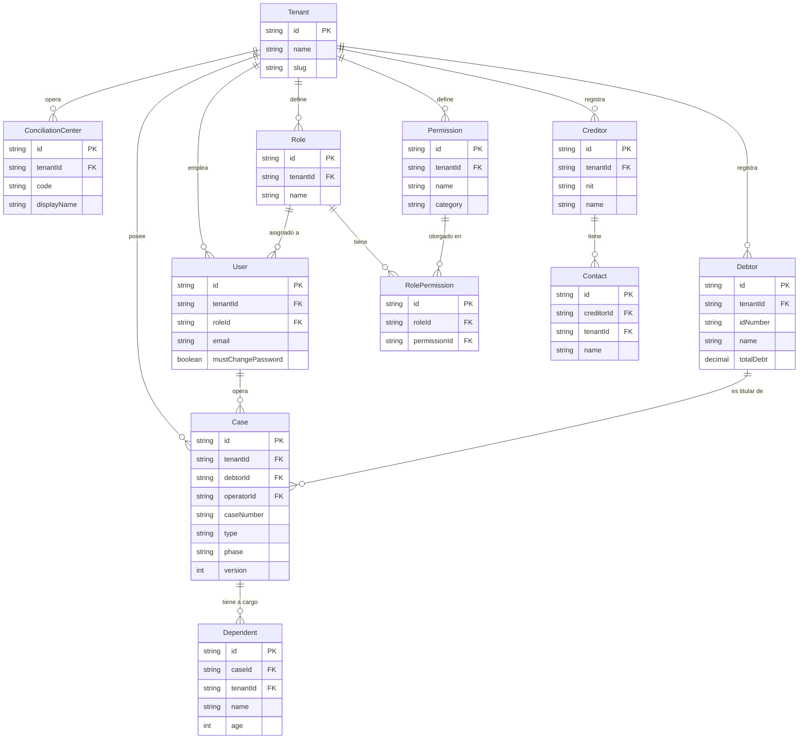
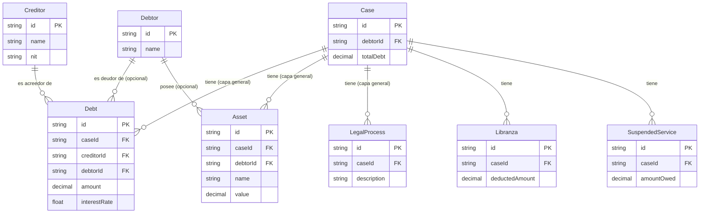
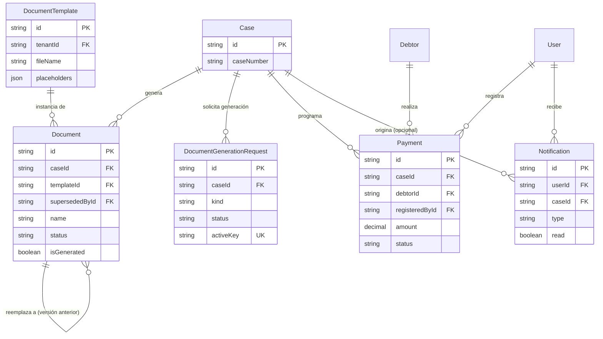

# Modelo Entidad-Relación (MER) — INSOLVENTIC

> Generado desde `src/prisma/schema.prisma` (25 modelos). Para el detalle campo-por-campo, tipos y constraints ver `docs/DICCIONARIO_DATOS.md` — este documento se enfoca en entidades, atributos estructurales (PK/FK y algunos representativos) y cardinalidad.

## Por qué 3 vistas y no 1

Un solo diagrama con las ~25 entidades y sus relaciones no es legible (es el mismo problema que tendría cualquier ERD de un sistema con formularios legales de ~400 campos). Se divide en 3 vistas temáticas que comparten algunas entidades "puente" (`Case`, `Debtor`, `Tenant`) para que se puedan leer por separado sin perder el hilo:

1. **Núcleo + Personas** — multi-tenant, RBAC, el caso, y las personas del dominio.
2. **Financiero/Patrimonial** — las entidades reutilizables de deuda, bienes y procesos judiciales.
3. **Documentos + Pagos + Operación** — generación documental, trazabilidad de pagos, notificaciones y auditoría.

`Tenant` es la raíz de aislamiento multi-tenant para las entidades restantes (cada una tiene `tenantId → Tenant`, N:1) — se muestra completo solo en la Vista 1 para no repetir flechas idénticas en las otras dos vistas.

---

## Vista 1 — Núcleo + Personas

**Notas de cardinalidad:** `Debtor ||--o{ Case` — un deudor puede tener varios expedientes (no es 1:1); `User ||--o{ Case` es el operador asignado (`Case.operatorId`), no el creador.

---

## Vista 2 — Financiero/Patrimonial

---

## Vista 3 — Documentos + Pagos + Operación

**No incluidas en el diagrama** (relacionan solo con `Tenant`, sin FK hacia `Case`): `DocumentFromDrive`, `PasswordResetToken`, `AuditLog` — ver `docs/DICCIONARIO_DATOS.md` §5 y §7 para su detalle completo. `AuditLog.userId/userName/userCedula` son copias desnormalizadas, no una FK formal a `User` — se preserva la traza aunque el usuario se borre.

---

© 2025–2026 INSOLVENTIC — generado desde `src/prisma/schema.prisma`.
