# INSOLVENTIC — Diagrama de Gantt del proyecto de grado

> Generado por `node docs/gantt/generar.mjs` desde `docs/gantt/datos.mjs`; no editar a mano.
> Corte: **21 oct 2026 (S12)**. Versión visual completa: [`gantt.html`](gantt.html) · hoja de cálculo: [`gantt.xlsx`](gantt.xlsx).

- **Periodo académico:** 25 semanas — S1–S17 en 2026-2 (03 ago 2026 → 29 nov 2026) y S18–S25 en 2027-1 (01 feb 2027 → 28 mar 2027). El receso no cuenta.
- **Antecedentes:** nov 2025 – jul 2026, con fechas reales del repositorio, fuera de las 25 semanas.
- **Avance:** 78 % del esfuerzo total · 67 % del periodo académico. Al corte de 2026-2 (29 nov) quedaría hecho el **81 % del esfuerzo** del periodo académico (17/25 semanas = 68 % del calendario).
- **Pasado = evidencia** (commit, PR o documento citado). **Futuro = estimado** (plan Jira, escenario bajo de 16 pts/semana, o estimación propia). Horas = puntos × 1.1; en lo completado son esfuerzo equivalente retroactivo, no horas medidas.

```mermaid
gantt
    title INSOLVENTIC — Proyecto de grado (corte 21 oct 2026)
    dateFormat YYYY-MM-DD
    axisFormat %b %y
    todayMarker off
    section Hitos
    H01 Creación del repositorio :done, milestone, h01, 2025-11-23, 0d
    H02 MVP etiquetado v0.1.0 :done, milestone, h02, 2026-03-08, 0d
    H03 v0.3.0 alertas Sentry y E2E en CI :done, milestone, h03, 2026-04-16, 0d
    H04 Inicio del semestre 2026-2 (S1) :done, milestone, h04, 2026-08-03, 0d
    H05 Auditoría pre-producción :done, milestone, h05, 2026-08-25, 0d
    H06 Auditorías pre-launch y de cierre producción estable :done, milestone, h06, 2026-09-11, 0d
    H07 Auditoría del formulario de conciliación :done, milestone, h07, 2026-10-12, 0d
    H08 Release candidate v1.0.0-rc.1 :done, milestone, h08, 2026-10-18, 0d
    H09 v1.0.0-rc.2 :milestone, h09, 2026-11-08, 0d
    H10 UAT firmado por ambos centros :crit, milestone, h10, 2026-11-22, 0d
    H11 Release 1.0.0 + corte del 70 % (fin de 2026-2) :crit, milestone, h11, 2026-11-29, 0d
    H12 Inicio del semestre 2027-1 (S18) :milestone, h12, 2027-02-01, 0d
    H13 v1.1.0 :milestone, h13, 2027-03-07, 0d
    H14 Entrega del documento final :crit, milestone, h14, 2027-03-21, 0d
    H15 Sustentación :crit, milestone, h15, 2027-03-26, 0d
    HOY corte 21 oct 2026 :crit, milestone, hoy, 2026-10-21, 0d
    section F0 Antecedentes (trabajo previo)
    A01 Análisis y diseño inicial (equipo de tesis) :done, a01, 2025-11-03, 2026-02-02
    A02 Prototipo base auth casos y documentos HTML :done, a02, 2026-02-02, 2026-03-02
    A03 Pruebas hardening y v0.1.0 :done, a03, 2026-03-02, 2026-03-16
    A04 RBAC auditoría dashboard pagos y reportes :done, a04, 2026-03-16, 2026-03-30
    A05 Conciliación DOCX alertas y Sentry (v0.2–v0.3) :done, a05, 2026-03-30, 2026-04-20
    A06 Acuerdos de Apoyo y pruebas de carga k6 :done, a06, 2026-04-20, 2026-04-27
    A07 Auditoría de documentos (P2–P4) y logger :done, a07, 2026-07-06, 2026-07-13
    section F1 Análisis y diseño
    T01 Requisitos MER diccionario y diagramas :done, t01, 2026-08-10, 2026-08-17
    T02 Diseño de las 5 fases nuevas del expediente :done, t02, 2026-09-11, 2026-09-12
    T03 Diseño del branding por centro :done, t03, 2026-09-30, 2026-10-02
    T04 Diseño del apoderado del acreedor (CYG) :done, t04, 2026-10-09, 2026-10-10
    T05 Backlog Jira proceso Scrum y cronograma :active, t05, 2026-10-19, 2026-10-26
    section F2 Construcción y remediación
    C01 Seguridad crítica (Semana 1) :done, c01, 2026-08-26, 2026-08-27
    C02 Rate limit health check y runbook (Semana 2) :done, c02, 2026-08-26, 2026-08-27
    C03 Lógica de negocio en el servidor (PR 4) :done, c03, 2026-09-02, 2026-09-12
    C04 Apoderados del deudor sesión y rendimiento :done, c04, 2026-09-14, 2026-09-21
    C05 Fechas y placeholders de documentos :done, c05, 2026-09-21, 2026-09-28
    C06 Ronda del formulario maestro :done, c06, 2026-09-28, 2026-10-04
    C07 Cinco fases nuevas del expediente (PR 40) :done, c07, 2026-09-28, 2026-10-01
    C08 División del placeholder-mapper :done, c08, 2026-09-29, 2026-10-04
    C09 Generación todos los acreedores y un navegador :done, c09, 2026-09-29, 2026-10-04
    C10 Correcciones de documentos (fechas causas apoyo) :done, c10, 2026-10-05, 2026-10-09
    C11 Membrete y branding por centro :done, c11, 2026-10-09, 2026-10-11
    C12 Apoderado del acreedor modelo y captura :done, c12, 2026-10-09, 2026-10-10
    C13 Separador de miles y ESLint en cero :done, c13, 2026-10-09, 2026-10-12
    C14 Bloqueantes de seguridad pre-entrega :done, c14, 2026-10-17, 2026-10-18
    C15 Formulario de conciliación completo :done, c15, 2026-10-17, 2026-10-18
    C16 Generación de lotes grandes en tandas :done, c16, 2026-10-17, 2026-10-18
    C17 Montos carpeta de Drive y apoderado único :done, c17, 2026-10-18, 2026-10-20
    C18 Bienes en dos niveles y notificaciones :done, c18, 2026-10-19, 2026-10-20
    C19 Riesgos de código bloqueo optimista y requisitos :c19, 2026-10-26, 2026-11-02
    C20 Bloquear el CYG con apoderado contradictorio :crit, c20, 2026-11-02, 2026-11-09
    C21 Documentos de Rechazo y de Retiro :c21, 2026-11-02, 2026-11-09
    C22 Resolver conflicto de apoderado en la UI :crit, c22, 2026-11-09, 2026-11-16
    C23 Regenerar documentos sin duplicados :c23, 2026-11-16, 2026-11-23
    C24 Estado de la generación visible en el caso :c24, 2026-11-16, 2026-11-23
    X02 v1.1 borrado lógico de expedientes :x02, 2027-02-08, 2027-02-22
    section F3 Infraestructura y despliegue
    I01 Deploy nativo Vercel y migraciones gateadas :done, i01, 2026-08-12, 2026-08-19
    I02 CI memoria del build y pruebas E2E :done, i02, 2026-09-04, 2026-09-11
    I03 Incidentes de producción y regla de autoría :done, i03, 2026-09-07, 2026-09-12
    I04 Runbooks de Drive y BD robustez del build :done, i04, 2026-09-18, 2026-09-21
    I05 Observabilidad y CI (Sentry versión caché) :done, i05, 2026-09-28, 2026-10-04
    I06 Migraciones desde cero y Postgres en CI :done, i06, 2026-10-08, 2026-10-10
    I07 CI en PRs apilados y versión rc.1 :done, i07, 2026-10-17, 2026-10-18
    I08 Desplegar sin reescribir el autor (plan Vercel) :crit, i08, 2026-11-23, 2026-11-26
    I09 Prueba real de restauración del backup :crit, i09, 2026-11-23, 2026-11-27
    I10 Verificación operativa en producción :i10, 2026-11-23, 2026-11-28
    I11 Transferir cuentas a los centros :crit, i11, 2026-11-25, 2026-11-29
    I12 Publicar 1.0.0 y entregar a los centros :crit, i12, 2026-11-28, 2026-11-30
    B01 Contingencia del release (solo si se desliza) :b01, 2026-11-30, 2026-12-12
    X01 Estabilización y operación asistida :x01, 2027-02-01, 2027-02-15
    X04 v1.1 observabilidad y seguridad :x04, 2027-02-01, 2027-02-22
    X03 v1.1 cerrar la deriva de migraciones :x03, 2027-02-15, 2027-03-01
    section F4 Calidad pruebas y cumplimiento
    Q01 Red de pruebas Postgres real y golden master :done, q01, 2026-09-19, 2026-09-21
    Q04 Fundamento normativo y pendientes legales :done, q04, 2026-10-01, 2026-10-10
    Q02 Plan de pruebas y verificación E2E de documentos :done, q02, 2026-10-03, 2026-10-04
    Q03 Suite formulario → BD → documento :done, q03, 2026-10-08, 2026-10-09
    Q05 Ley 1581 privacidad términos ARCO y manual :done, q05, 2026-10-17, 2026-10-18
    Q06 Política de versiones al regenerar (spike) :q06, 2026-10-26, 2026-11-02
    Q07 Legal I SMMLV 2026 y Check List Parágrafo 3 :q07, 2026-11-02, 2026-11-09
    Q08 Cierre técnico de rc.2 (Sentry y docs) :q08, 2026-11-02, 2026-11-09
    Q09 Legal II umbrales y cuenta de Armonía :q09, 2026-11-09, 2026-11-16
    Q10 Ley 1581 retención privacidad y ARCO :q10, 2026-11-09, 2026-11-16
    Q11 Prueba E2E de aislamiento entre centros :crit, q11, 2026-11-16, 2026-11-19
    Q12 UAT con guion por rol en ambos centros :crit, q12, 2026-11-18, 2026-11-23
    Q13 Buffer correcciones post-UAT :q13, 2026-11-23, 2026-11-30
    X05 v1.1 pendientes legales :x05, 2027-02-08, 2027-03-08
    X06 v1.1 deuda técnica y pruebas :x06, 2027-02-22, 2027-03-08
    section F5 Documentación de tesis y cierre
    D01 Informe de avance del 70 % :crit, d01, 2026-10-26, 2026-11-30
    D02 Documento final de tesis :crit, d02, 2027-02-01, 2027-03-22
    D03 Guía y manuales de mantenimiento (v1.1) :d03, 2027-03-01, 2027-03-15
    D04 Actas de aceptación de los centros :crit, d04, 2027-03-08, 2027-03-22
    D05 Preparación de la sustentación :crit, d05, 2027-03-15, 2027-03-27
    D06 Buffer de cierre :d06, 2027-03-22, 2027-03-29
```

> En Mermaid el eje es lineal: los antecedentes (9 meses) ocupan más ancho que en el HTML, que los comprime en escala mensual. La línea de HOY es el hito `hoy` (fecha de corte), no la fecha en que se renderiza el diagrama.

## Fases

| Fase                            | Inicio      | Fin         | Tareas | Horas | Avance |
| ------------------------------- | ----------- | ----------- | ------ | ----- | ------ |
| Antecedentes (trabajo previo)   | 03 nov 2025 | 12 jul 2026 | 7      | 347   | 100%   |
| Análisis y diseño               | 10 ago 2026 | 25 oct 2026 | 5      | 20    | 88%    |
| Construcción y remediación      | 26 ago 2026 | 21 feb 2027 | 25     | 396   | 87%    |
| Infraestructura y despliegue    | 12 ago 2026 | 28 feb 2027 | 15     | 100   | 61%    |
| Calidad, pruebas y cumplimiento | 19 sep 2026 | 07 mar 2027 | 14     | 97    | 39%    |
| Documentación de tesis y cierre | 26 oct 2026 | 28 mar 2027 | 5      | 76    | 0%     |

## Hitos

| ID  | Hito                                                  | Fecha       | Semana      | Estado     | Base             | Fuente                                                                              |
| --- | ----------------------------------------------------- | ----------- | ----------- | ---------- | ---------------- | ----------------------------------------------------------------------------------- |
| H01 | Creación del repositorio                              | 23 nov 2025 | Ant. nov-25 | Completado | Evidencia (repo) | 74736d6 first commit                                                                |
| H02 | MVP etiquetado v0.1.0                                 | 08 mar 2026 | Ant. mar-26 | Completado | Evidencia (repo) | 3cc0b73 · CHANGELOG [0.1.0]                                                         |
| H03 | v0.3.0: alertas, Sentry y E2E en CI                   | 16 abr 2026 | Ant. abr-26 | Completado | Evidencia (repo) | 820461c · CHANGELOG [0.3.0]                                                         |
| H04 | Inicio del semestre 2026-2 (S1)                       | 03 ago 2026 | S1          | Completado | Dato del autor   | Calendario académico (dato del autor)                                               |
| H05 | Auditoría pre-producción                              | 25 ago 2026 | S4          | Completado | Evidencia (repo) | docs/AUDITORIA_PREPRODUCCION_2026-08-25.md                                          |
| H06 | Auditorías pre-launch y de cierre; producción estable | 11 sep 2026 | S6          | Completado | Evidencia (repo) | 17c7de2 (AUDITORIA_INTEGRAL_PRE_LAUNCH) · 96f478d (AUDITORIA_CIERRE) · main d2f7cef |
| H07 | Auditoría del formulario de conciliación              | 12 oct 2026 | S11         | Completado | Evidencia (repo) | docs/AUDITORIA_FORMULARIO_CONCILIACION_2026-10-12.md                                |
| H08 | Release candidate v1.0.0-rc.1                         | 18 oct 2026 | S11         | Completado | Evidencia (repo) | 2a35e51 · CHANGELOG [1.0.0-rc.1]                                                    |
| H09 | v1.0.0-rc.2                                           | 08 nov 2026 | S14         | Pendiente  | Estimado         | Jira Fix Version v1.0.0-rc.2 (PROCESO_SCRUM §4.8, §5.5)                             |
| H10 | **UAT firmado por ambos centros**                     | 22 nov 2026 | S16         | Pendiente  | Estimado         | Jira E14-14 (sprint W47)                                                            |
| H11 | **Release 1.0.0 + corte del 70 % (fin de 2026-2)**    | 29 nov 2026 | S17         | Pendiente  | Estimado         | Jira E10-30 (sprint W48) · requisito académico del 70 %                             |
| H12 | Inicio del semestre 2027-1 (S18)                      | 01 feb 2027 | S18         | Pendiente  | Dato del autor   | Calendario académico (dato del autor)                                               |
| H13 | v1.1.0                                                | 07 mar 2027 | S22         | Pendiente  | Estimado         | Jira Fix Version v1.1.0 (ítems Should)                                              |
| H14 | **Entrega del documento final**                       | 21 mar 2027 | S24         | Pendiente  | Estimado         | Estimado (fecha a confirmar con la universidad)                                     |
| H15 | **Sustentación**                                      | 26 mar 2027 | S25         | Pendiente  | Estimado         | Estimado (fecha a confirmar con la universidad)                                     |

## Ruta crítica

C12 Apoderado del acreedor (hecho) → C20 Bloqueo del CYG · S14 → C22 Conflicto de apoderado en la UI · S15 → Q12 UAT en ambos centros · S16 → I12 Release 1.0.0 · S17 (29 nov) → D02 Documento final · S18–S24 → D05 Sustentación · S25

Ramas que convergen en ella:

- Q11 Aislamiento entre centros → Q12 UAT
- I08 Plan de Vercel → I11 Transferencia de cuentas → I12 Release
- I09 Restauración del backup → I12 Release
- D01 Informe del 70 % → H11 Corte 2026-2 → D02 Documento final
- H10 UAT firmado + H13 v1.1.0 → D04 Actas de aceptación → H15 Sustentación

Fuera de la ruta crítica, a propósito: Q07, Q09, Q10 y C21 (legal-pendiente: si la respuesta no llega pasan a v1.1, ver R1) y C24 (Should, primer ítem en moverse si falta capacidad, ver R2).

## Buffers

- **Q13** — correcciones post-UAT en S17 (los 4 pts libres del sprint W48 ≈ 5 h).
- **B01** — contingencia del release, 30 nov – 11 dic, en el receso. Solo se usa si el release se desliza (R2, R3, R4).
- **D06** — buffer de cierre en S25, para las correcciones del jurado.

## Riesgos

| ID  | Riesgo                                                                                                                            | Prob. | Impacto  | Impacto en el cronograma                                                                                                               | Mitigación                                                                                                                            |
| --- | --------------------------------------------------------------------------------------------------------------------------------- | ----- | -------- | -------------------------------------------------------------------------------------------------------------------------------------- | ------------------------------------------------------------------------------------------------------------------------------------- |
| R1  | Las respuestas legales (abogada, centros) no llegan a tiempo: SMMLV, Check List P3, umbrales, textos de Rechazo/Retiro, Ley 1581. | Alta  | Alto     | Q07, Q09, Q10 y C21 (S14–S15) pasan a v1.1 en 2027-1. El release 1.0.0 no se mueve (no dependen de él), pero sale sin esos documentos. | Enviar una sola hoja con reglas y valores a confirmar al inicio de S13; registrar respuestas en PENDIENTES_DECISION_LEGAL.md.         |
| R2  | Capacidad al tope en S13–S17: 16 pts/semana + informe del 70 % ≈ 19–20 h/semana, justo en parciales y finales.                    | Alta  | Alto     | Release y corte del 70 % +1 semana (consume la contingencia B01, 30 nov – 11 dic).                                                     | C24 (Should, 3 pts) es el primero en pasar a v1.1; recalibrar la velocidad al cerrar S14 (PROCESO_SCRUM §5.2).                        |
| R3  | Los centros no tienen agenda para ejecutar y firmar el UAT en S16.                                                                | Media | Alto     | Sin UAT no hay release (I12 depende de H10): +1 semana.                                                                                | Agendar al cerrar S14 y enviar el guion una semana antes; permitir firmas por separado; I09/I11 siguen en paralelo.                   |
| R4  | El backup de producción nunca se ha restaurado: el runbook es teórico.                                                            | Media | Muy alto | Si falla en S17, el release espera la corrección (contingencia B01).                                                                   | I09 antes del release; si se puede, adelantarlo a S15.                                                                                |
| R5  | El plan Hobby de Vercel bloquea deploys por el autor del commit.                                                                  | Alta  | Medio    | Cada deploy requiere un amend manual; si se olvida, el release de S17 queda Blocked.                                                   | Regla de autoría de CLAUDE.md; solución de fondo en I08 (vincular la cuenta o pasar a Pro).                                           |
| R6  | Desarrollador único: el conocimiento está en una persona y en los documentos de sesión.                                           | Alta  | Alto     | Cualquier ausencia detiene la ruta crítica.                                                                                            | Runbooks, manual, CLAUDE.md al día (Q08) y transferencia de cuentas (I11).                                                            |
| R7  | Reconocimiento académico del trabajo previo (Antecedentes, nov 2025 – jul 2026) ante el director y el jurado.                     | Media | Alto     | No mueve el software. Si no se acuerda pronto, obliga a reescribir el informe del 70 % (D01).                                          | Acordarlo con el director al inicio de S13 y presentarlo como prototipo previo con fechas reales. El historial de git no se modifica. |
| R8  | Cerrar la deriva de migraciones requiere acceso a Neon y una ventana segura.                                                      | Baja  | Alto     | X03 (S20–S21) puede quedar documentada sin cerrarse; no bloquea la sustentación.                                                       | Guardián BRECHA_CONOCIDA en tests/db; decidir el camino (catch-up vs. baseline) en el spike E10-28.                                   |
| R9  | Receso de diciembre y enero: producción sin cobertura y pérdida de contexto.                                                      | Media | Medio    | S18–S19 se dedican a estabilizar antes de abrir v1.1.                                                                                  | Alertas proactivas activas, runbook de incidentes, X01 al regreso.                                                                    |
| R10 | Decisiones del cliente sin ratificar: bloqueo duro vs. marca de agua; generación individual vs. por lote.                         | Media | Medio    | Cambia el alcance de C19, C24 y Q12; puede reabrir trabajo en S16.                                                                     | Llevar ambas preguntas a la review de S13 con ejemplos.                                                                               |
| R11 | Las fechas de entrega del documento final y de la sustentación no están confirmadas.                                              | Media | Medio    | H14/H15 pueden moverse dentro de 2027-1; D02 y D05 se reajustan.                                                                       | Confirmar el calendario de 2027-1 en cuanto se publique y actualizar datos.mjs.                                                       |

## Semanas académicas

| Semana    | Lunes       | Domingo     | Semestre | ISO      |
| --------- | ----------- | ----------- | -------- | -------- |
| S1        | 03 ago 2026 | 09 ago 2026 | 2026-2   | 2026-W32 |
| S2        | 10 ago 2026 | 16 ago 2026 | 2026-2   | 2026-W33 |
| S3        | 17 ago 2026 | 23 ago 2026 | 2026-2   | 2026-W34 |
| S4        | 24 ago 2026 | 30 ago 2026 | 2026-2   | 2026-W35 |
| S5        | 31 ago 2026 | 06 sep 2026 | 2026-2   | 2026-W36 |
| S6        | 07 sep 2026 | 13 sep 2026 | 2026-2   | 2026-W37 |
| S7        | 14 sep 2026 | 20 sep 2026 | 2026-2   | 2026-W38 |
| S8        | 21 sep 2026 | 27 sep 2026 | 2026-2   | 2026-W39 |
| S9        | 28 sep 2026 | 04 oct 2026 | 2026-2   | 2026-W40 |
| S10       | 05 oct 2026 | 11 oct 2026 | 2026-2   | 2026-W41 |
| S11       | 12 oct 2026 | 18 oct 2026 | 2026-2   | 2026-W42 |
| S12 ← HOY | 19 oct 2026 | 25 oct 2026 | 2026-2   | 2026-W43 |
| S13       | 26 oct 2026 | 01 nov 2026 | 2026-2   | 2026-W44 |
| S14       | 02 nov 2026 | 08 nov 2026 | 2026-2   | 2026-W45 |
| S15       | 09 nov 2026 | 15 nov 2026 | 2026-2   | 2026-W46 |
| S16       | 16 nov 2026 | 22 nov 2026 | 2026-2   | 2026-W47 |
| S17       | 23 nov 2026 | 29 nov 2026 | 2026-2   | 2026-W48 |
| S18       | 01 feb 2027 | 07 feb 2027 | 2027-1   | 2027-W05 |
| S19       | 08 feb 2027 | 14 feb 2027 | 2027-1   | 2027-W06 |
| S20       | 15 feb 2027 | 21 feb 2027 | 2027-1   | 2027-W07 |
| S21       | 22 feb 2027 | 28 feb 2027 | 2027-1   | 2027-W08 |
| S22       | 01 mar 2027 | 07 mar 2027 | 2027-1   | 2027-W09 |
| S23       | 08 mar 2027 | 14 mar 2027 | 2027-1   | 2027-W10 |
| S24       | 15 mar 2027 | 21 mar 2027 | 2027-1   | 2027-W11 |
| S25       | 22 mar 2027 | 28 mar 2027 | 2027-1   | 2027-W12 |

## Tareas

⚑ = ruta crítica.

| ID  | Fase                            | Tarea                                              | Sem. inicio | Duración | Depende de    | Estado      | %    | Horas | Base             | Fuente                                                                                                      |
| --- | ------------------------------- | -------------------------------------------------- | ----------- | -------- | ------------- | ----------- | ---- | ----- | ---------------- | ----------------------------------------------------------------------------------------------------------- |
| A01 | Antecedentes (trabajo previo)   | Análisis y diseño inicial (equipo de tesis)        | Ant. nov-25 | 13 sem   | —             | Completado  | 100% | 40    | Inferido         | docs/diseno/Diagrama de Gantt - Insolventic.png · Jira E00-01…E00-08 (fechas inferidas, PROCESO_SCRUM §5.1) |
| A02 | Antecedentes (trabajo previo)   | Prototipo base: auth, casos y documentos HTML      | Ant. feb-26 | 4 sem    | A01           | Completado  | 100% | 58    | Evidencia (repo) | 72493d9 · 83d2d71 · df0ba7c · ba65470 · fcd2670                                                             |
| A03 | Antecedentes (trabajo previo)   | Pruebas, hardening y v0.1.0                        | Ant. mar-26 | 2 sem    | A02           | Completado  | 100% | 40    | Evidencia (repo) | c40cfb7 (111 tests) · abfc674 · 0b3c085 · 3cc0b73                                                           |
| A04 | Antecedentes (trabajo previo)   | RBAC, auditoría, dashboard, pagos y reportes       | Ant. mar-26 | 2 sem    | A03           | Completado  | 100% | 59    | Evidencia (repo) | eaf4df4 · 6323d88 · 82812b5 · e777c30                                                                       |
| A05 | Antecedentes (trabajo previo)   | Conciliación, DOCX, alertas y Sentry (v0.2–v0.3)   | Ant. mar-26 | 3 sem    | A04           | Completado  | 100% | 106   | Evidencia (repo) | CHANGELOG [0.2.0] y [0.3.0] · 820461c                                                                       |
| A06 | Antecedentes (trabajo previo)   | Acuerdos de Apoyo y pruebas de carga k6            | Ant. abr-26 | 1 sem    | A05           | Completado  | 100% | 12    | Evidencia (repo) | 19e4227 · 2c43446                                                                                           |
| A07 | Antecedentes (trabajo previo)   | Auditoría de documentos (P2–P4) y logger           | Ant. jul-26 | 1 sem    | A06           | Completado  | 100% | 32    | Evidencia (repo) | docs/AUDITORIA_MODULO_GENERACION_2026-07.md · 758b733 · 177cf24 · 40a5a59                                   |
| T01 | Análisis y diseño               | Requisitos, MER, diccionario y diagramas           | S2          | 1 sem    | —             | Completado  | 100% | 6     | Evidencia (repo) | 660fffd (REQUISITOS_INSOLVENTIC.xlsx) · 849d96b (diccionario, MER, clases) · 7280aa9 (componentes)          |
| T02 | Análisis y diseño               | Diseño de las 5 fases nuevas del expediente        | S6          | 1 sem    | —             | Completado  | 100% | 2     | Evidencia (repo) | 9da5173 · docs/DISENO_FASES_NUEVAS_2026-09-11.md                                                            |
| T03 | Análisis y diseño               | Diseño del branding por centro                     | S9          | 1 sem    | —             | Completado  | 100% | 2     | Evidencia (repo) | #82 74aec37 · docs/BRANDING_POR_CENTRO_2026-09-30.md                                                        |
| T04 | Análisis y diseño               | Diseño del apoderado del acreedor (CYG)            | S10         | 1 sem    | —             | Completado  | 100% | 2     | Evidencia (repo) | bfaa37a · docs/PLAN_APODERADO_ACREEDOR_CYG_2026-10-10.md                                                    |
| T05 | Análisis y diseño               | Backlog Jira, proceso Scrum y cronograma           | S12         | 1 sem    | —             | En progreso | 70%  | 8     | Evidencia (repo) | docs/jira/ y docs/IMPLEMENTACION_SEMANA_6–15.md (sin commitear) · docs/gantt/                               |
| C01 | Construcción y remediación      | Seguridad crítica (Semana 1)                       | S4          | 1 sem    | H05           | Completado  | 100% | 10    | Evidencia (repo) | docs/IMPLEMENTACION_SEMANA_1.md · bfdeb47 · 9e037be · a9a1e4d · c507501                                     |
| C02 | Construcción y remediación      | Rate limit, health check y runbook (Semana 2)      | S4          | 1 sem    | H05           | Completado  | 100% | 12    | Evidencia (repo) | docs/IMPLEMENTACION_SEMANA_2.md · 8a8a1ae · 57fd2c5 · f542f22                                               |
| C03 | Construcción y remediación      | Lógica de negocio en el servidor (PR #4)           | S5          | 2 sem    | C01           | Completado  | 100% | 25    | Evidencia (repo) | docs/IMPLEMENTACION_SEMANA_3.md · PR #4 17c7de2                                                             |
| C04 | Construcción y remediación      | Apoderados del deudor, sesión y rendimiento        | S7          | 1 sem    | C03           | Completado  | 100% | 29    | Evidencia (repo) | e05e409 · issue #9 · e7af5bf · f87a5ec · 276eea4                                                            |
| C05 | Construcción y remediación      | Fechas y placeholders de documentos                | S8          | 1 sem    | —             | Completado  | 100% | 7     | Evidencia (repo) | 7d74953 · d55ac1a                                                                                           |
| C06 | Construcción y remediación      | Ronda del formulario maestro                       | S9          | 1 sem    | C04           | Completado  | 100% | 47    | Evidencia (repo) | PRs #60–#103 · docs/HALLAZGOS_CALIDAD_FORMULARIO_2026-09-28.md                                              |
| C07 | Construcción y remediación      | Cinco fases nuevas del expediente (PR #40)         | S9          | 1 sem    | T02           | Completado  | 100% | 21    | Evidencia (repo) | #40 a0ac5d7 · docs/DEPLOY_PR40.md                                                                           |
| C08 | Construcción y remediación      | División del placeholder-mapper                    | S9          | 1 sem    | Q01           | Completado  | 100% | 23    | Evidencia (repo) | #52 d1320ae · #100 93e1efe · docs/PLAN_DIVISION_MAPPER.md                                                   |
| C09 | Construcción y remediación      | Generación: todos los acreedores y un navegador    | S9          | 1 sem    | —             | Completado  | 100% | 26    | Evidencia (repo) | #57 2a202f9 · #77 ce8dcb3 · #110 b32e892                                                                    |
| C10 | Construcción y remediación      | Correcciones de documentos (fechas, causas, apoyo) | S10         | 1 sem    | Q02           | Completado  | 100% | 19    | Evidencia (repo) | #112 · #113 · #117 · #118 · #119 · #120                                                                     |
| C11 | Construcción y remediación      | Membrete y branding por centro                     | S10         | 1 sem    | T03           | Completado  | 100% | 30    | Evidencia (repo) | #121 · #126 · #128 · #132–#135 · docs/CHECKPOINT_2026-10-09.md                                              |
| C12 | Construcción y remediación      | Apoderado del acreedor: modelo y captura           | S10         | 1 sem    | T04           | Completado  | 100% | 9     | Evidencia (repo) | #130 af53a6f · #131 613e327                                                                                 |
| C13 | Construcción y remediación      | Separador de miles y ESLint en cero                | S10         | 1 sem    | —             | Completado  | 100% | 11    | Evidencia (repo) | #136 c678020 · #124 4df5906 · #123 33ec217                                                                  |
| C14 | Construcción y remediación      | Bloqueantes de seguridad pre-entrega               | S11         | 1 sem    | H07           | Completado  | 100% | 28    | Evidencia (repo) | docs/IMPLEMENTACION_SEMANA_4.md y \_7.md · #137 7ab6b5e · #140 376d83b                                      |
| C15 | Construcción y remediación      | Formulario de conciliación completo                | S11         | 1 sem    | H07           | Completado  | 100% | 15    | Evidencia (repo) | docs/IMPLEMENTACION_SEMANA_5.md y \_6.md · #138 fe82fe6 · #139 0a41c56                                      |
| C16 | Construcción y remediación      | Generación de lotes grandes en tandas              | S11         | 1 sem    | C09           | Completado  | 100% | 9     | Evidencia (repo) | #140 376d83b · issue #3 · docs/IMPLEMENTACION_SEMANA_7.md                                                   |
| C17 | Construcción y remediación      | Montos, carpeta de Drive y apoderado único         | S11         | 1 sem    | —             | Completado  | 100% | 15    | Evidencia (repo) | #144 · #145 · #146 · #147 · docs/IMPLEMENTACION_SEMANA_10–13.md                                             |
| C18 | Construcción y remediación      | Bienes en dos niveles y notificaciones             | S12         | 1 sem    | —             | Completado  | 100% | 9     | Evidencia (repo) | #148 25d6d7e · #149 b29166c · docs/IMPLEMENTACION_SEMANA_14–15.md                                           |
| C19 | Construcción y remediación      | Riesgos de código: bloqueo optimista y requisitos  | S13         | 1 sem    | —             | Pendiente   | 0%   | 15    | Estimado         | Jira sprint W44 (PROCESO_SCRUM §5.5)                                                                        |
| C20 | Construcción y remediación      | Bloquear el CYG con apoderado contradictorio ⚑     | S14         | 1 sem    | C12           | Pendiente   | 0%   | 6     | Estimado         | Jira sprint W45                                                                                             |
| C21 | Construcción y remediación      | Documentos de Rechazo y de Retiro                  | S14         | 1 sem    | C07           | Pendiente   | 0%   | 6     | Estimado         | Jira sprint W45 · legal-pendiente (R1)                                                                      |
| C22 | Construcción y remediación      | Resolver conflicto de apoderado en la UI ⚑         | S15         | 1 sem    | C20           | Pendiente   | 0%   | 6     | Estimado         | Jira sprint W46                                                                                             |
| C23 | Construcción y remediación      | Regenerar documentos sin duplicados                | S16         | 1 sem    | Q06           | Pendiente   | 0%   | 6     | Estimado         | Jira sprint W47                                                                                             |
| C24 | Construcción y remediación      | Estado de la generación visible en el caso         | S16         | 1 sem    | —             | Pendiente   | 0%   | 3     | Estimado         | Jira sprint W47 · Should: primer ítem en moverse si falta capacidad                                         |
| X02 | Construcción y remediación      | v1.1: borrado lógico de expedientes                | S19         | 2 sem    | Q10           | Pendiente   | 0%   | 9     | Estimado         | Jira v1.1.0 · CLAUDE.md Fase 3 (soft-delete)                                                                |
| I01 | Infraestructura y despliegue    | Deploy nativo Vercel y migraciones gateadas        | S2          | 1 sem    | —             | Completado  | 100% | 8     | Evidencia (repo) | ae6b2ae · 6090f1f · 70868c6 · CLAUDE.md Session 3                                                           |
| I02 | Infraestructura y despliegue    | CI: memoria del build y pruebas E2E                | S5          | 1 sem    | I01           | Completado  | 100% | 4     | Evidencia (repo) | #5 1ad141b · #12 2360250                                                                                    |
| I03 | Infraestructura y despliegue    | Incidentes de producción y regla de autoría        | S6          | 1 sem    | I01           | Completado  | 100% | 13    | Evidencia (repo) | docs/CHECKPOINT_2026-09-09.md · a54d92e · #13 e9dd65a · 596dae6                                             |
| I04 | Infraestructura y despliegue    | Runbooks de Drive y BD; robustez del build         | S7          | 1 sem    | —             | Completado  | 100% | 9     | Evidencia (repo) | 1b7f7cd · 516bac9 · 5a7bec3 · 50d96ed                                                                       |
| I05 | Infraestructura y despliegue    | Observabilidad y CI (Sentry, versión, caché)       | S9          | 1 sem    | —             | Completado  | 100% | 11    | Evidencia (repo) | #38 cb4c525 · #55 db9c215 · #109 da6e928 · #111 a9802ee · 3eccc72                                           |
| I06 | Infraestructura y despliegue    | Migraciones desde cero y Postgres en CI            | S10         | 1 sem    | —             | Completado  | 100% | 13    | Evidencia (repo) | #58 7733272 · #122 2f1375c · #127 92b416b · 0dad100 · docs/DIAGNOSTICO_PROMOCION_MAIN_2026-10-08.md         |
| I07 | Infraestructura y despliegue    | CI en PRs apilados y versión rc.1                  | S11         | 1 sem    | —             | Completado  | 100% | 3     | Evidencia (repo) | #142 7edc0cf · 2a35e51                                                                                      |
| I08 | Infraestructura y despliegue    | Desplegar sin reescribir el autor (plan Vercel) ⚑  | S17         | 1 sem    | —             | Pendiente   | 0%   | 2     | Estimado         | Jira sprint W48 · issue #7                                                                                  |
| I09 | Infraestructura y despliegue    | Prueba real de restauración del backup ⚑           | S17         | 1 sem    | —             | Pendiente   | 0%   | 3     | Estimado         | Jira sprint W48 · docs/RUNBOOK.md                                                                           |
| I10 | Infraestructura y despliegue    | Verificación operativa en producción               | S17         | 1 sem    | —             | Pendiente   | 0%   | 3     | Estimado         | Jira sprint W48                                                                                             |
| I11 | Infraestructura y despliegue    | Transferir cuentas a los centros ⚑                 | S17         | 1 sem    | I08           | Pendiente   | 0%   | 3     | Estimado         | Jira sprint W48 (inferido)                                                                                  |
| I12 | Infraestructura y despliegue    | Publicar 1.0.0 y entregar a los centros ⚑          | S17         | 1 sem    | H10, I09, I11 | Pendiente   | 0%   | 1     | Estimado         | Jira sprint W48                                                                                             |
| B01 | Infraestructura y despliegue    | Contingencia del release (solo si se desliza)      | Receso      | 2 sem    | I12           | Pendiente   | 0%   | 0     | Estimado         | Reserva fuera de las 25 semanas: absorbe R2/R3 sin mover el corte académico más de 2 semanas                |
| X01 | Infraestructura y despliegue    | Estabilización y operación asistida                | S18         | 2 sem    | I12           | Pendiente   | 0%   | 8     | Estimado         | Estimado: primeras semanas tras el receso (R9)                                                              |
| X04 | Infraestructura y despliegue    | v1.1: observabilidad y seguridad                   | S18         | 3 sem    | I11           | Pendiente   | 0%   | 11    | Estimado         | Jira v1.1.0                                                                                                 |
| X03 | Infraestructura y despliegue    | v1.1: cerrar la deriva de migraciones              | S20         | 2 sem    | —             | Pendiente   | 0%   | 8     | Estimado         | Jira v1.1.0 · CLAUDE.md Fase 3 (requiere acceso a Neon)                                                     |
| Q01 | Calidad, pruebas y cumplimiento | Red de pruebas: Postgres real y golden master      | S7          | 1 sem    | —             | Completado  | 100% | 12    | Evidencia (repo) | 73841cc · 5ad7934 · e572146                                                                                 |
| Q04 | Calidad, pruebas y cumplimiento | Fundamento normativo y pendientes legales          | S9          | 2 sem    | —             | Completado  | 100% | 6     | Evidencia (repo) | #90 fe7e1df · 0f15dbf · #129 1683150 · docs/PENDIENTES_DECISION_LEGAL.md                                    |
| Q02 | Calidad, pruebas y cumplimiento | Plan de pruebas y verificación E2E de documentos   | S9          | 1 sem    | —             | Completado  | 100% | 3     | Evidencia (repo) | docs/VERIFICACION_E2E_DOCUMENTOS_2026-10-03.md · docs/TESTS.md                                              |
| Q03 | Calidad, pruebas y cumplimiento | Suite formulario → BD → documento                  | S10         | 1 sem    | —             | Completado  | 100% | 6     | Evidencia (repo) | #116 925c007                                                                                                |
| Q05 | Calidad, pruebas y cumplimiento | Ley 1581: privacidad, términos, ARCO y manual      | S11         | 1 sem    | —             | Completado  | 100% | 11    | Evidencia (repo) | #141 6aa58d1 · docs/PROCEDIMIENTO_ARCO.md · docs/MANUAL_USUARIO.md                                          |
| Q06 | Calidad, pruebas y cumplimiento | Política de versiones al regenerar (spike)         | S13         | 1 sem    | —             | Pendiente   | 0%   | 2     | Estimado         | Jira sprint W44 · legal-pendiente                                                                           |
| Q07 | Calidad, pruebas y cumplimiento | Legal I: SMMLV 2026 y Check List Parágrafo 3       | S14         | 1 sem    | —             | Pendiente   | 0%   | 4     | Estimado         | Jira sprint W45 · legal-pendiente (R1)                                                                      |
| Q08 | Calidad, pruebas y cumplimiento | Cierre técnico de rc.2 (Sentry y docs)             | S14         | 1 sem    | —             | Pendiente   | 0%   | 2     | Estimado         | Jira sprint W45                                                                                             |
| Q09 | Calidad, pruebas y cumplimiento | Legal II: umbrales y cuenta de Armonía             | S15         | 1 sem    | —             | Pendiente   | 0%   | 4     | Estimado         | Jira sprint W46 · legal-pendiente (R1)                                                                      |
| Q10 | Calidad, pruebas y cumplimiento | Ley 1581: retención, privacidad y ARCO             | S15         | 1 sem    | Q05           | Pendiente   | 0%   | 8     | Estimado         | Jira sprint W46 · legal-pendiente (R1)                                                                      |
| Q11 | Calidad, pruebas y cumplimiento | Prueba E2E de aislamiento entre centros ⚑          | S16         | 1 sem    | —             | Pendiente   | 0%   | 3     | Estimado         | Jira sprint W47                                                                                             |
| Q12 | Calidad, pruebas y cumplimiento | UAT con guion por rol en ambos centros ⚑           | S16         | 1 sem    | Q11, C22      | Pendiente   | 0%   | 6     | Estimado         | Jira sprint W47 (R3)                                                                                        |
| Q13 | Calidad, pruebas y cumplimiento | Buffer: correcciones post-UAT                      | S17         | 1 sem    | Q12           | Pendiente   | 0%   | 5     | Estimado         | Holgura del sprint W48 (12/16 pts usados ⇒ 4 pts libres)                                                    |
| X05 | Calidad, pruebas y cumplimiento | v1.1: pendientes legales                           | S19         | 4 sem    | —             | Pendiente   | 0%   | 15    | Estimado         | Jira v1.1.0 · legal-pendiente · issue #16                                                                   |
| X06 | Calidad, pruebas y cumplimiento | v1.1: deuda técnica y pruebas                      | S21         | 2 sem    | —             | Pendiente   | 0%   | 15    | Estimado         | Jira v1.1.0 (ítems Should)                                                                                  |
| D01 | Documentación de tesis y cierre | Informe de avance del 70 % ⚑                       | S13         | 5 sem    | —             | Pendiente   | 0%   | 12    | Estimado         | Estimado: entregable académico del semestre 2026-2                                                          |
| D02 | Documentación de tesis y cierre | Documento final de tesis ⚑                         | S18         | 7 sem    | D01, I12      | Pendiente   | 0%   | 40    | Estimado         | Estimado · Gantt original: "Documento final y actas de aceptación"                                          |
| D03 | Documentación de tesis y cierre | Guía y manuales de mantenimiento (v1.1)            | S22         | 2 sem    | X01           | Pendiente   | 0%   | 8     | Estimado         | Estimado · Gantt original: "Guía y manuales de mantenimiento" · docs/RUNBOOK.md                             |
| D04 | Documentación de tesis y cierre | Actas de aceptación de los centros ⚑               | S23         | 2 sem    | H10, H13      | Pendiente   | 0%   | 4     | Estimado         | Estimado · Gantt original: "actas de aceptación"                                                            |
| D05 | Documentación de tesis y cierre | Preparación de la sustentación ⚑                   | S24         | 2 sem    | D02           | Pendiente   | 0%   | 12    | Estimado         | Estimado                                                                                                    |
| D06 | Documentación de tesis y cierre | Buffer de cierre                                   | S25         | 1 sem    | D02           | Pendiente   | 0%   | 4     | Estimado         | Holgura para correcciones del jurado                                                                        |
